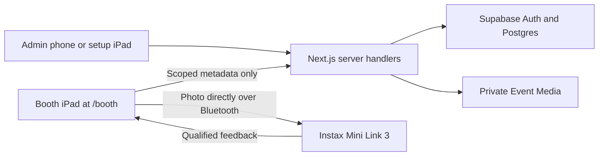

# DIY Instax Photo Booth — Architecture

**Status:** Approved target architecture, revised 2026-10-21. Version-2 schema, trusted handlers and provisional simulator code are verified for the #9 software prerequisite; the [issue #9 review](docs/implementation/issue-9-package-contracts-review.md) records the passing 2026-10-25 software acceptance and retained failures; GitHub #9 closure remains pending. Existing Admin/Booth UI remains on legacy flows until #10. No hosted activation or physical qualification has occurred.
**Behavior:** [PRD](PRD.md). **Normative transitions, access, data and APIs:** [replacement contract](docs/superpowers/specs/2026-10-21-package-accounting-booth-recovery-design.md). **Decision:** [ADR-0025](docs/adr/0025-package-accounting-and-booth-recovery.md).

## 1. System boundary

Guest photos stay in browser memory and go directly to the printer. Server/database/logs receive only anonymous session, Capture and attempt metadata. Event Media is private stored content, separate from Guest photos.

## 2. Technology and responsibilities

| Layer       | Choice                                                  | Responsibility                                                                    |
| ----------- | ------------------------------------------------------- | --------------------------------------------------------------------------------- |
| Application | Next.js 16 App Router, React, TypeScript                | Server-rendered Admin pages, scoped handlers and browser Booth UI                 |
| Interface   | Tailwind CSS 4, shadcn/ui, Lucide, locally served Geist | Shared semantic tokens from DESIGN_SYSTEM.md                                      |
| Validation  | Zod and React Hook Form plus database constraints       | Boundary validation, meaningful form errors, invariant enforcement                |
| Identity    | Supabase Auth and SSR cookies                           | Sole Admin; live-session revocation checks                                        |
| Data        | Supabase Postgres                                       | Transactional packages, sessions, attempts, grants, lifecycle, receipts and audit |
| Media       | Private Supabase Storage                                | Optional Event background/montage only                                            |
| Printer     | Replaceable browser adapter                             | Connection/readiness, one send, correlated physical observations                  |
| Hosting     | Vercel Pro                                              | Paid-event production application; separate staging/production Supabase           |

Shared UI lives in `src/components/{ui,shared,layout}`; feature state stays in `src/features/`. See ADR-0020 and ADR-0019. Domain transitions and accounting are separate from React and printer protocol. The simulator implements the same observation contract but cannot qualify hardware or enable production.

Admin starts on the iPad at `/events/[eventId]`, completes local sign-out/device handoff and enters `/booth`. Its opaque grant selects the run; no Event ID belongs in the guest URL. The phone remains at the authenticated Event page for recovery and lifecycle actions. Next.js Proxy may refresh sessions or redirect early; handlers/database enforce final authority. Read the installed Next.js guides before implementation.

## 3. Admin authentication

The sole Admin is provisioned through Supabase Auth; the application has no public signup. Admin reads and writes use the Admin's verified Auth identity and row-level security (RLS). Policies must check the provisioned Admin identity, not merely the `authenticated` database role. Enable RLS and deliberate grants on every exposed table and on Storage objects. Server rendering and mutations recheck authorization at the data boundary. Authenticated responses and routes that refresh cookies are private and uncached. Ordinary sign-in goes to `/dashboard`. Exceptional setup recovery may return to an Event page only after authentication and validation of an internal destination. Routine pause/recovery stays at `/booth`.

Profile **Sign out** uses Supabase Auth's local scope and clears only the current device's Admin session. Password recovery sends a link from `/forgot-password` to `/reset-password` through Supabase Auth; the configured redirect URL is restricted to the application's approved origins and the recovery pages reveal no account existence or protected data. Production requires reliable SMTP delivery for recovery email. A reset reports completion only after Auth accepts a password different from the current one and confirms global revocation of Admin sessions, including the temporary recovery session. A `same_password` response is a field error, never evidence of an earlier save. If the revocation response fails after saving, the server checks the live-session RLS boundary: a confirmed-active recovery session can submit another different password to retry; a revoked or unverifiable recovery session is directed to request a new recovery link without claiming all sessions ended. Client form state is not trusted as proof of the save. Because already-issued access JWTs can remain valid after Supabase sign-out, final Admin authorization must also reject revoked sessions rather than relying on JWT validity alone. Resetting the password does not revoke an active Booth Access Grant, whose scope and lifecycle are independent of Admin sessions. See [ADR-0015](docs/adr/0015-complete-admin-reset-only-after-password-change-and-revocation.md).

The recovery action uses Auth's token-scoped global revocation call, preserving its local recovery cookie if the remote call fails. After confirmed global revocation, it clears that cookie. A different-password retry is available only when the live-session RLS boundary confirms that the recovery session remains active.

## 4. Booth access and transactions

The [contract sections 5–6](docs/superpowers/specs/2026-10-21-package-accounting-booth-recovery-design.md#5-database-and-access-rules) define records, lock order, grant renewal, operation receipts and endpoint shapes. Their version-2 server contracts are implemented for local verification; existing UI consumers remain on legacy flows until #10.

- Handlers authenticate Admin or scoped device proof and enforce same-origin/CSRF. Private, no-store responses; server-only secrets never go to the browser.
- Admin RLS permits authorized reads, Profile edits and validated Draft edits. Accounting, package additions, lifecycle, grants, reload confirmation and print transitions go through private database functions; functions recheck authority/state inside the transaction.
- The global single-printer/single-Live-Event guard, then Event, run, attempt/reload-request locks serialize competing work. Constraints defend uniqueness. Counters, transitions, receipt and audit commit together.
- Every mutation has a stable actor-scoped operation ID and payload fingerprint. Retry the same payload/key after ambiguous responses. Replays cannot send a printer command or add/count twice.
- Each unresolved attempt holds one booked print. `total = 10 × (original + additional packages)`; `available = total − Printed − unresolved`. No physical inventory balance is maintained.
- Grants survive Paused and temporary faults, but Paused/Finishing scopes allow only status/reconciliation/pending reports. Finished/terminal/security revocation ends access. Missing/expired proof fails closed; password reset is independent.
- A finite renewable idle expiry and explicit polling policy are in the contract. Recovery with invalid access uses authenticated same-run replacement setup: the iPad signs Admin out locally, the replacement grant activates into Paused, and phone Resume remains explicit. Finishing/Finished cannot be replaced. Equipment readiness is stage-specific; dynamic reports expire after five seconds while same-printer reconnect retains prior physical load confirmation unless invalidated by a new load/empty fault.

## 5. Capture, dispatch and recovery

The client journals non-photo operation metadata before reservation and before sending. A failed journal write blocks dispatch. The server uses stage-specific guards: setup needs no existing grant; Start/reservation need available capacity; dispatch validates its own Reserved hold without requiring another unit. It reserves one print, then authorizes dispatch under the same state locks as pause/finish. A first dispatch authorization allows one send; replay is status-only. A reload or ambiguous dispatch response never authorizes another send. Scoped reconciliation cancels Reserved only when the server proves dispatch never committed; Admin recovery can do the same after device-proof loss. Possible delivery remains pending. Database idempotency cannot itself make Bluetooth exactly-once; the one-send barrier and conservative Pending state cover that gap.

A completed shutter has one idempotent Capture record. [ADR-0026](docs/adr/0026-order-captures-by-shutter-time.md) orders acknowledged Captures by their validated `captured_at`, independent of arrival/UUID order. Reserve requires the selected version-2 Capture in the same session/run with no strictly newer acknowledged shutter in that session; dispatch rechecks its bound `capture_id` by the same rule. Equal timestamps allow either explicitly selected Capture. Older/tied metadata arriving later cannot invalidate that selection; genuinely newer metadata blocks dispatch, leaving the unsent hold for existing NotPrinted reconciliation. No photo substitution, sequence field or selection endpoint is added. Guest Session abandonment and photo disposal do not clear its Print Attempt. Full ejection counts once; known not-sent/reliable no-output releases the hold. Unknown keeps hold and printer slot until reliable feedback or Admin inspection. Terminal conflicts create an audit discrepancy and block the affected run instead of silently rewriting counts. The contract preserves the bounded metadata-only Capture report at stop; it does not extend print authority after revocation.

Temporary readiness is a set of independent blockers. Connection recovery, package addition or film load confirmation removes only the relevant blocker and never clears an explicit pause. Bluetooth Connect to Instax and camera Enable Camera are limited local controls on `/booth`. Phone Admin resolves pending outcomes and confirms physical reload. The exact required messages and precedence are in the PRD/contract.

A pause/finish committed before dispatch denies it. If dispatch committed first, a command may still print despite a later stop. Stop new work, observe/resolve the old attempt, then complete Finish. Cancellation of delivered commands is not promised. No automatic resend, same-photo retry after a fault, or new session while a prior job can still eject.

## 6. Media, retention and validation

Private Event Media uses opaque Event-ID object paths and short-lived URLs issued only after authorization. Validate image/video format, size and the montage's maximum 30-second duration. Montage is welcome-only and silent, with pause and reduced-motion fallback. A background never enters the captured image. Guest image bytes, Client contact copies, secrets and signed URLs are excluded from logs/telemetry.

Draft saves reject invalid/ambiguous venue-local times, non-whole/negative package counts and stale revisions. Original booking fields freeze when Live. Additional package entries are positive whole units with Client-request note and audit identity. No Client-redaction or terminal Event-delete route exists in the target. Draft deletion removes private media and identifying details, reports cleanup pending on failure, and retains opaque audit references. Completed/Cancelled records and their media remain under Admin access.

Existing UI consumers, records and the local creation default still use the old accounting model. Version-2 schema and handlers are installed without global activation. Contract section 8 requires a later coordinated cutover, legacy snapshots, resolution of old pending work before conversion, explicit review of Draft capacity changes, and retirement of obsolete mutation paths. Do not alter applied migrations or pretend historical refunds/counts followed the new rules.

## 7. Verification and delivery

The [issue #9 review](docs/implementation/issue-9-package-contracts-review.md) records local contract-test evidence for transactions/concurrency, package limits, idempotency, stale state, RLS/denials, active-session revocation, grant handoff/expiry, receipt recovery, one-send journal and stop/dispatch races. Issue #10 still owns integrated camera/Bluetooth/network/reload presentation and phone/Guest browser journeys. Simulation remains nonproduction and cannot establish physical printer completion.

The [proof checklist](docs/qualification/booth-recovery-proof-checklist.md) controls hardware work. Normal automatic full-ejection completion is mandatory; exceptional phone inspection cannot substitute. The actual iPad A16 end-to-end gate remains mandatory. The [#17 report](docs/qualification/issue-17-trial-report.md) preserves the partial iPhone evidence, including the misleading printer count. No fresh hardware trial has occurred.

Later delivery uses versioned migrations and Storage policies in a confirmed separate staging Supabase project before production. GitHub Actions should run lint, types, unit/integration and browser checks. Vercel previews use staging configuration; Vercel Pro production uses separate production secrets/data. Keep schema rollout compatible until old paths are retired. Docker supports local Supabase development. No hosted deployment or activation occurred in this review.
