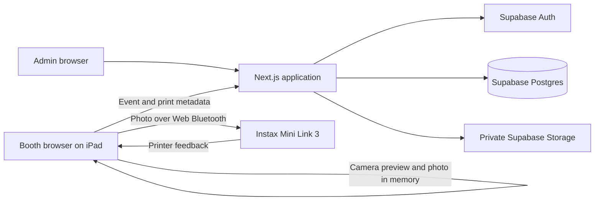

# DIY Instax Photo Booth — Architecture

**Status:** Proposed for the first release. Direct browser printing remains conditional on the target-device trial.
**Date:** 2026-10-11
**Basis:** [Product requirements](PRD.md), [architecture prompt](docs/prompts/architecture-prompt.md), [glossary](GLOSSARY.md), and [decision records](docs/adr/).
**Interface guidance:** [Design system](DESIGN_SYSTEM.md).

## 1. System boundary

The product has one Admin account, one booth iPad A16, one Instax Mini Link 3 printer, and at most one Live Event at a time. Booking and payment are outside the product. The first release requires internet access for Guest Sessions and print accounting.

Guest photo bytes stay in booth browser memory and go directly to the printer. They never pass through Next.js, Supabase, activity logs, or telemetry. The browser sends only non-photo metadata and printer outcomes to the server. This boundary depends on the hardware trial proving direct printing and reliable film-ejection feedback.

## 2. Technology and responsibilities

| Layer                | Choice                                   | Responsibility                                                                                   |
| -------------------- | ---------------------------------------- | ------------------------------------------------------------------------------------------------ |
| Web application      | Next.js 16 App Router, React, TypeScript | Admin pages, Booth Mode shell, server rendering, and Route Handlers                              |
| Interface            | Tailwind CSS, shadcn/ui, Lucide          | Components follow DESIGN_SYSTEM.md; camera and Bluetooth controls are Client Components          |
| Validation and forms | Zod, React Hook Form                     | Validate Admin input and server requests; database constraints remain authoritative              |
| Identity             | Supabase Auth and `@supabase/ssr`        | Sole Admin email/password account and cookie-based server session                                |
| Data                 | Supabase Postgres                        | Event records, grants, anonymous activity, reservations, ledger, and transactional state changes |
| Media                | Private Supabase Storage                 | Optional Event background and montage only                                                       |
| Printer boundary     | Browser-side printer adapter             | Web Bluetooth connection, image encoding, command delivery, and film-ejection feedback           |
| Hosting              | Vercel Pro                               | Production Next.js runtime for paid Events                                                       |

The public authentication pages are `/sign-in`, `/forgot-password`, and `/reset-password`. The protected Admin route group contains Dashboard, Events, History, and Profile. Server Components load protected data; Client Components handle forms and interactive controls. Booth Mode is a separate route group. Its camera, countdown, review, and printer adapter run in Client Components because they need browser APIs. Booth requests use Next.js Route Handlers, which validate the Booth Access Grant on every request. Next.js Proxy may refresh Supabase Auth cookies or perform an early redirect, but final authorization happens in the server handler and database operation.

Keep domain rules for Event transitions, allowance, stock, and Print Attempt outcomes separate from UI and printer protocol code. The printer adapter exposes a small interface so tests can substitute a simulated printer without changing the Guest flow.

## 3. Identity and access

### Admin

The sole Admin is provisioned through Supabase Auth; the application has no public signup. Admin reads and writes use the Admin's verified Auth identity and row-level security (RLS). Policies must check the provisioned Admin identity, not merely the `authenticated` database role. Enable RLS and deliberate grants on every exposed table and on Storage objects. Server rendering and mutations recheck authorization at the data boundary. Authenticated responses and routes that refresh cookies are private and uncached. Ordinary sign-in goes to `/dashboard`; a same-device paused-booth return goes to the relevant Live Event management page only after authentication. Validate this return context on the server and allow only internal Admin destinations.

Profile **Sign out** uses Supabase Auth's local scope and clears only the current device's Admin session. Password recovery sends a link from `/forgot-password` to `/reset-password` through Supabase Auth; the configured redirect URL is restricted to the application's approved origins and the recovery pages reveal no account existence or protected data. Production requires reliable SMTP delivery for recovery email. After a successful reset, globally revoke Admin sessions, including the temporary recovery session, and require fresh password sign-in. Because already-issued access JWTs can remain valid after Supabase sign-out, final Admin authorization must also reject revoked sessions rather than relying on JWT validity alone. Resetting the password does not revoke an active Booth Access Grant, whose scope and lifecycle are independent of Admin sessions.

Starting Booth Mode validates readiness, makes the Event Live, prepares an inactive Booth Access Grant, and signs the Admin out **locally on the iPad** using Supabase's local sign-out scope. The server activates the grant and sets its cookie only after sign-out succeeds; the response clears Admin cookies as it sets the booth cookie. A failed handoff leaves the Event Live but paused, with no usable grant, so the Admin can sign in and recover. Local sign-out preserves an Admin session on a second device. Returning to Admin pages requires sign-in. Profile password changes use Supabase Auth's authenticated flow.

### Booth Access Grant

The grant is a random opaque secret in a `Secure`, `HttpOnly`, `SameSite` cookie. Postgres stores only its hash, Event/run scope, expiry, and revocation state. Booth handlers check the cookie, grant record, Live Event, and allowed transition; state-changing requests also enforce same-origin/CSRF protections. A grant gives access only to non-sensitive Live Event configuration, availability, anonymous Capture recording, and Print Attempt operations. It cannot read Client contact details or perform Admin actions.

The booth sends no direct Supabase table requests. Server-only credentials invoke narrow Postgres operations for booth mutations; their grants and input checks must prevent general table access by the booth. Do not expose a privileged key to the browser or make privileged database functions callable by `anon` or ordinary `authenticated` clients.

An ordinary reload or short connection loss keeps the grant. Pausing or ending Booth Mode revokes it and clears the booth cookie. A paused Event remains Live; the Admin signs in and issues a new grant to resume. Expired or revoked grants fail closed. Guided Access and the target-device navigation trial provide the physical kiosk boundary.

## 4. Data model

The names below describe the intended model; migration names and exact columns can be finalized during implementation. All persistent IDs are opaque. Dates representing instants are stored in UTC. Each Event also stores an IANA venue time zone so its local schedule and month grouping remain stable.

| Record                     | Core fields and relationships                                                                                                                                                                     | Purpose                                                                                          |
| -------------------------- | ------------------------------------------------------------------------------------------------------------------------------------------------------------------------------------------------- | ------------------------------------------------------------------------------------------------ |
| `admin_profiles`           | Auth user ID, phone, light/dark preference                                                                                                                                                        | Profile data and provisioned Admin identity                                                      |
| `events`                   | ID, title, venue address and time zone, UTC start/end, Draft/Live/Completed/Cancelled state, Film Package count, original Print Allowance, Event-specific Client name/email/phone, redaction time | Booking snapshot and Event lifecycle; there is no shared Client table                            |
| `event_media`              | Event ID, background or montage kind, private Storage object key, validated format/size/duration                                                                                                  | Optional Booth Mode media; never guest photos                                                    |
| `booth_runs`               | Event ID, start/end, active/paused state, setup confirmations and printer test status                                                                                                             | Operational state while the Event remains Live                                                   |
| `booth_grants`             | Run/Event ID, token hash, issued/expiry/revocation times                                                                                                                                          | Revocable booth access after iPad Admin sign-out                                                 |
| `guest_sessions`           | Event ID, anonymous session ID, start/end, outcome                                                                                                                                                | One Guest's flow without a Guest account or photo                                                |
| `captures`                 | Guest Session ID, unique operation ID, capture time                                                                                                                                               | One row per shutter press, including Retakes; no image data                                      |
| `print_attempts`           | Event ID, optional Guest Session ID, Guest/Test kind, unique request key, current outcome, command/ejection times, Admin resolution                                                               | One physical print command and its Print/Film Reservations                                       |
| `print_attempt_events`     | Print Attempt ID, transition, time, actor, reason                                                                                                                                                 | Append-only history of outcomes, including Uncertain Print resolution and Wasted Film correction |
| `additional_print_entries` | Event ID, amount, time, Admin actor                                                                                                                                                               | Append-only increases to an Event's Print Allowance                                              |
| `film_stock_entries`       | Signed sheet change, reason, time, actor, optional Event/Print Attempt ID, observed count for reconciliation                                                                                      | Append-only shared inventory history                                                             |
| `film_stock_balance`       | Single current on-hand count, revision                                                                                                                                                            | Transactionally maintained balance and lock for reservations; reconciled against stock entries   |
| `activity_events`          | Event ID or opaque deleted-Event reference, action, time, actor, safe metadata                                                                                                                    | Paginated Dashboard activity without Client contact snapshots or image data                      |

The Print Reservation and Film Reservation are holds represented by an unresolved `print_attempts` row. A Test Print has only a Film Reservation. The original allowance is fixed on the Event; Additional Prints are separate entries. Confirmed Prints and open reservations determine remaining allowance. A Wasted Film correction changes the Print Attempt's current outcome and appends a correction event, while its consumed sheet stays recorded in the stock ledger. The linked Guest Session remains closed; its original photo cannot be reused.

Activity entries reference the Event and action rather than copying Client details. Event displays use the Event's current title and contact state so Client Redaction affects every view. A deleted Draft Event appears by an opaque reference and action, without retaining its Client details or former title.

Dashboard and History queries use scheduled start time for Event counts and UTC instants for upcoming comparisons. The Dashboard groups each Event into its venue-local scheduled month. Activity is ordered newest first, filtered to 7 or 30 days, and paginated in batches of 25. Index Event state/start and activity time/ID for these access patterns; never materialize Client contact fields in activity rows.

## 5. Database invariants and accounting

Postgres enforces the following in transactions and constraints:

1. At most one Event is Live across the system, and at most one Print Attempt uses the single printer at a time.
2. A new Guest Session requires positive remaining Print Allowance and available Film Stock. A Print Attempt acquires its holds before the browser sends a command.
3. Each client operation has a stable idempotency key. A repeat request returns the existing result; it cannot create a second Capture, reservation, stock change, or print outcome.
4. Each Print Attempt transition commits its applicable reservation or outcome, allowance effect, stock entry, and activity entry in one Postgres transaction. The reservation commits before the browser sends the Bluetooth command; the outcome commits in a later transaction after printer feedback or Admin resolution. Lock the Event and shared stock balance during reservation or consumption. The ledger remains append-only; the current balance is a transactionally maintained read model checked against it.
5. A clear pre-film rejection releases both Guest holds. Verified ejection consumes one sheet and provisionally counts a Confirmed Print. Test Print ejection consumes only stock. An uncertain outcome retains the applicable holds and blocks new Guest Sessions.
6. The Admin may reclassify an unusable ejected Guest print as Wasted Film. This restores one allowance unit through an auditable correction while leaving the stock consumption in place; a replacement requires a new Guest Session and Capture.
7. Completing or cancelling an Event requires every Print and Film Reservation to be resolved. Physical-count reconciliation requires no pending Film Reservation; stock additions remain allowed while an attempt is pending.
8. Client and booking fields remain fixed while the Event is Live. Readiness is calculated from setup checks rather than stored as an Event state.

Remaining guest allowance:

`original Print Allowance + Additional Prints − Confirmed Prints − unresolved Print Reservations`

Available Film Stock:

`current on-hand balance − unresolved Film Reservations`

The on-hand balance reflects additions, Test Prints, Guest prints, and reconciliations. The Admin enters an observed sheet count and reason after resolving holds; the system records the computed difference as a stock entry.

The physical Bluetooth command cannot join a Postgres transaction. The reservation commits first; the browser then sends the command and reports its result. If delivery or feedback is ambiguous, the holds remain until physical inspection. Database idempotency prevents duplicate records, while the booth also prevents a second Bluetooth send for the same attempt.

| Print Attempt transition            | Allowance effect                                      | Film Stock effect                                |
| ----------------------------------- | ----------------------------------------------------- | ------------------------------------------------ |
| New Guest attempt → reserved        | Hold one                                              | Hold one sheet                                   |
| New Test Print → reserved           | None                                                  | Hold one sheet                                   |
| Reserved → clear pre-film rejection | Release hold                                          | Release hold                                     |
| Reserved → ejection confirmed       | Consume Guest hold                                    | Consume one sheet                                |
| Reserved → uncertain                | Keep Guest hold                                       | Keep sheet hold                                  |
| Uncertain → Admin resolution        | Consume or release Guest hold according to inspection | Consume or release sheet according to inspection |
| Confirmed Guest print → Wasted Film | Restore one allowance unit                            | No second stock change                           |

## 6. Main data flows

### Event setup and Booth Mode entry

1. The Admin signs in, creates a Draft Event, and enters its Client contact snapshot, venue-local schedule, Film Packages, and original Print Allowance. The server validates the time zone and converts the schedule to UTC instants.
2. Optional Event Media goes to private Storage under an Event ID-based path. The Admin records stock additions. The iPad checks camera, internet, and printer connection; the Admin confirms power, loaded film, and Guided Access.
3. The browser prints a generated calibration image. The Test Print gets a Film Reservation and consumes stock on ejection; the Admin confirms that the output is usable before readiness passes. A printer reconnection requires a new successful Test Print.
4. A transactional start checks readiness and the single-Live-Event rule, marks the Event Live, creates a booth run and inactive grant, and records activity. The iPad's Admin session is signed out locally, then the grant activates and the booth cookie is set before Guests take over.

### Guest capture and print

1. The booth checks availability through its server endpoint before Start. Mirrored front-camera preview, portrait Instax Mini crop, and the 3–2–1 countdown run locally. The review presents the unmirrored final crop used for printing. Each shutter press creates a Capture metadata request with a stable operation ID; only non-photo IDs and metadata may be kept locally for retry after reload.
2. The Guest may Retake without using allowance. The selected image stays in browser memory; Print waits for Capture metadata acknowledgement. A warning near the end of the 90-second inactivity period lets the Guest continue; otherwise the image is discarded and the booth returns to welcome.
3. Print requests a transaction that checks the Live Event, grant, Guest Session, allowance, stock, and absence of another active attempt. It creates a Print Attempt with one Print Reservation and one Film Reservation.
4. The browser adapter encodes and sends the image directly over Web Bluetooth. The authorized booth reports a clear pre-film rejection, reliable film ejection, or uncertainty, always naming the pending attempt. The server validates the transition and commits the appropriate counts and journal entries.
5. After accepted ejection, the browser closes the Guest Session, discards the image, and returns to welcome. The Guest does not wait for chemical development. An Uncertain Print pauses the booth for Admin inspection and is never resent automatically.

### Pause, recovery, and redaction

- A pause requested during printing waits for the attempt's result. If the flow is interrupted, the attempt is Uncertain and requires Admin resolution. A pause before printing discards the photo, retains Captures, revokes the grant, and resumes later at welcome.
- A reload before printing loses the in-memory photo. Non-photo Capture metadata can retry idempotently. A reload after reservation is treated as uncertain when command delivery cannot be ruled out.
- The Admin resolves an Uncertain Print as ejected or clearly unused based on physical inspection; an unusable ejected Guest print may be recorded as Wasted Film. Resolving a Guest attempt as ejected closes its Guest Session and discards any photo still in memory. A replacement after Wasted Film starts a new Guest Session and Capture. The resolution writes an outcome event and updates holds and balances transactionally.
- Client Redaction clears Client name/email/phone and removes Event Media for a Completed or Cancelled Event. The app stops issuing media access, deletes the private objects, and reports completion only after removal succeeds. The Admin can rename an identifying Event title. Anonymous Event, Capture, print, and stock totals remain.

## 7. Media, privacy, and failure behavior

Private Storage contains only Event Media. Admin uploads are scoped by Event. After validating the Booth Access Grant, the server issues short-lived signed URLs only for the Live Event's media. Validate image type, video type, file size, and the montage's 30-second limit before accepting media. Storage object paths use opaque Event IDs, not Client names. The optional image appears on welcome and around the camera preview, but never enters the captured or printed photo. The montage is welcome-only; the image or default screen provides its fallback and reduced-motion presentation. Delete objects during Client Redaction rather than relying on URL expiry alone; previously cached responses may take a short time to disappear from a CDN. If a Storage deletion fails, keep redaction visibly incomplete and retry removal without restoring the already cleared Client fields.

Neither logs nor error reports include photo bytes, Client email/phone, grant secrets, or signed media URLs. Browser memory holding a photo is cleared after confirmation, cancellation, timeout, pause before print, or abandonment. A network loss pauses new sessions; an image waiting to print remains only in memory until service returns or the Admin cancels. If command delivery is known not to have happened, restored service and availability return the Guest to review for an explicit Print action; the booth does not send automatically. Camera or printer disconnects request Admin help. A print command with an unclear physical result creates an Uncertain Print and holds allowance and stock until resolution.

## 8. Verification and delivery

The iPhone evidence now permits integrated Admin and Booth development using a simulated printer and a replaceable browser-side printer adapter. Issue #8 still controls its unresolved operational rules. Keep printer command acceptance separate from verified physical ejection in the adapter and server contracts. The qualification harness remains supervised and must not become an unattended Guest print path. Live Event and Booth Access Grant code may be developed and tested, but printer-backed Live Event operation, Test Prints, stock consumption, and Confirmed Print accounting must not be completed or enabled until the physical completion checkpoint in [ADR-0014](docs/adr/0014-move-print-qualification-to-integration-checkpoint.md) passes.

The first hardware milestone produced partial evidence on the owner's iPhone 15 Plus, Bluefy, and Mini Link 3. Seven fresh-film prints matched the reviewed crop and orientation. A later uninterrupted run printed three used sheets with Retake and exhausted the local allowance; the operator reported that the UI blocked a fourth trial, and the log has no fourth print command. The printer-reported count did not represent the physical sheets loaded. The standard status count and `12 7f` field remain diagnostic candidates, not proof of full ejection. The original [issue #17 qualification design](docs/superpowers/specs/2026-10-13-iphone-print-qualification-design.md) records the stricter historical gate; the [current evidence report](docs/qualification/issue-17-trial-report.md) distinguishes fresh and used-film results. Verify actual device and software versions again in any further physical trial.

Integrated development may proceed now, with the physical completion approach unresolved. Reliable automatic ejection detection remains preferred. A supervised/manual production approach requires a separate explicit design and validation decision; qualification-page taps alone are insufficient. Until then, no ambiguous attempt may become a Confirmed Print or be automatically resent. The iPhone remains a development/test device. The purchased iPad A16 is the sole first-release Booth Mode device and must pass its own full trial before launch, including portrait layout, Guided Access, camera and Bluetooth coexistence, physical printing and the chosen ejection-confirmation approach, three Guest Sessions, Retake, allowance exhaustion, disconnect recovery, and continuous printer power. Record its exact model and iPadOS version. If the iPad shows a different printer or browser contract, revise shared code and accounting rules as needed, then reverify. See [ADR-0014](docs/adr/0014-move-print-qualification-to-integration-checkpoint.md).

During the full build, Vitest covers accounting rules and idempotent state transitions; React Testing Library covers form and Guest flow behavior; Playwright covers Admin and Booth Mode journeys against a simulated printer. Authentication tests cover sign-in, current-device Profile sign-out, neutral recovery requests, invalid/expired links, global Admin session revocation after reset, and same-device paused return without automatic Booth resume. Database integration tests exercise concurrent reservations, RLS allow/deny cases, revoked-session denial, stock reconciliation, Client Redaction, and failure recovery. The physical completion checkpoint precedes printer-backed operation; the real iPad trial remains the release acceptance test for Bluetooth, fullscreen, and printer feedback.

GitHub Actions runs lint, type checking, unit/integration tests, and Playwright checks. Versioned database migrations and Storage policies go to a separate staging Supabase project first, followed by production after validation. Schema changes remain compatible with the currently deployed application during promotion. Vercel preview deployments use staging configuration; production uses Vercel Pro and a separate production Supabase project. Server-only credentials stay in deployment secrets and never use a `NEXT_PUBLIC_` prefix. Docker may support local Supabase development and a future Node deployment; production hosting is Vercel Pro.

## 9. Reference guidance

- [Next.js 16 Route Handlers](https://nextjs.org/docs/app/getting-started/route-handlers), [Server and Client Components](https://nextjs.org/docs/app/getting-started/server-and-client-components), and [Proxy guidance](https://nextjs.org/docs/app/getting-started/proxy).
- [Supabase SSR client setup](https://supabase.com/docs/guides/auth/server-side/creating-a-client?framework=nextjs&queryGroups=framework), [sign-out scopes](https://supabase.com/docs/reference/javascript/auth-signout), [password recovery](https://supabase.com/docs/guides/auth/passwords), and [SSR caching guidance](https://supabase.com/docs/guides/auth/server-side/advanced-guide).
- [Supabase RLS](https://supabase.com/docs/guides/database/postgres/row-level-security), [database functions](https://supabase.com/docs/guides/database/functions), and [Storage access control](https://supabase.com/docs/guides/storage/security/access-control).
- [Supabase Storage CDN invalidation](https://supabase.com/docs/guides/storage/cdn/smart-cdn) and [Vercel Next.js deployment](https://vercel.com/docs/frameworks/full-stack/nextjs).
