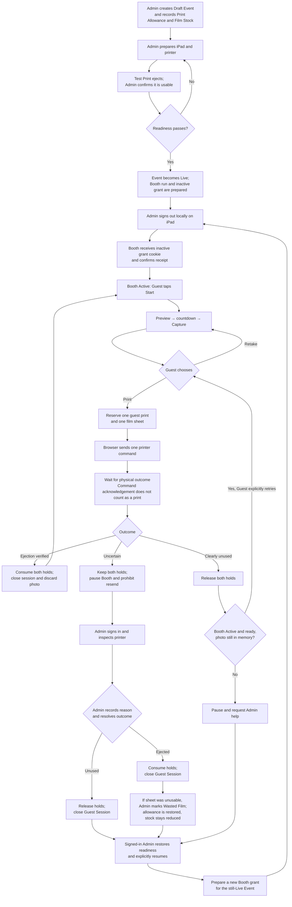

# Booth user flow after issue #9 implementation

This diagram shows the intended Admin and Guest flow defined by the [accounting, access, and provisional printer contract](superpowers/specs/2026-10-16-accounting-access-printer-contracts-design.md). It describes the current local simulated implementation as of 2026-10-18; final combined verification is tracked separately. Integrated development may use a simulated printer; real printer-backed Booth Mode and Confirmed Print accounting remain gated by the physical-ejection decision and validation in [ADR-0021](adr/0021-move-print-qualification-to-integration-checkpoint.md). The actual iPad trial is a separate release gate.

## Route map

| Step                                                                         | Route                                                                                                                                                                                                                                                                        |
| ---------------------------------------------------------------------------- | ---------------------------------------------------------------------------------------------------------------------------------------------------------------------------------------------------------------------------------------------------------------------------- |
| Admin opens the Event and chooses **Start Booth Mode**                       | `/events/[eventId]` — the agreed Admin entry in the [PRD](../PRD.md#enter-and-leave).                                                                                                                                                                                        |
| Server prepares the Live Event, run, and inactive grant                      | `POST /api/admin/events/{eventId}/booth-handoffs`.                                                                                                                                                                                                                           |
| Server signs out the iPad Admin session and issues the inactive Booth cookie | `POST /api/admin/booth-handoffs/{handoffId}/issue`.                                                                                                                                                                                                                          |
| iPad opens the guest-facing page and confirms the grant                      | `/booth`; it calls `POST /api/booth/handoffs/confirm` before showing Guest actions. The implemented route is recorded in [ADR-0023](adr/0023-use-a-single-booth-page-route.md). A one-use opaque `handoff` query reference is removed promptly; the URL carries no Event ID. |
| Pause or failed handoff requires Admin sign-in                               | `/sign-in`, then `/events/[eventId]` after successful same-device sign-in; the Admin explicitly selects **Resume Booth Mode**.                                                                                                                                               |

An Admin pause or remote stop before reservation ends preview or review and discards the unprinted photo. A completed Capture remains counted. If reservation wins the race, the Booth run enters `PauseRequested`: new Guest work stops while the matching attempt finishes or becomes Uncertain. Event completion or cancellation waits until all Print and Film Reservations are resolved. A resumed Booth starts at welcome with a new grant; it never restores a Guest photo.

## Integrated stop and recovery paths

The protected Admin management page is `/events/[eventId]`; `/booth` is the Guest page. An invalid or revoked grant presents only a neutral paused surface and sign-in link, without Event or Client details or printer diagnostics. The server validates the same-device return context after authentication before returning to Event management. Sign-in alone never resumes; the Admin reviews readiness and explicitly selects **Resume Booth Mode**.

A deliberate protected pause uses `PauseRequested` if a Print Attempt is reserved. It stops new Guest work and preserves the matching attempt's final or uncertain outcome reporting before revocation. A detected printer connection change instead conservatively makes a pending attempt Uncertain, keeps its holds, and pauses/revokes immediately. Admin recovery resolves uncertainty, obtains a fresh Test Print and immutable usable-output inspection tied to the new connection, and creates a new handoff. These paths do not restore a Guest photo. A fired shutter's delayed metadata may still be counted under the bounded two-minute exception in [ADR-0024](adr/0024-preserve-integrated-booth-operation-boundaries.md).

## Additional operation routes

This contextual inventory supplements the frozen approved spec. Bodies are strict JSON; `operationKey` and path IDs are UUIDs. Requests require same-origin validation and the appropriate active Admin or Booth authority. Simulator operation remains explicitly gated outside production.

| Route                                                    | Request body                        | Result and boundary                                                                                                                                                                                                                                      |
| -------------------------------------------------------- | ----------------------------------- | -------------------------------------------------------------------------------------------------------------------------------------------------------------------------------------------------------------------------------------------------------- |
| `POST /api/admin/print-attempts/{attemptId}/test-output` | `{ operationKey, usable: boolean }` | Admin-only immutable inspection of ejected Test output; returns `attemptId`, `state`, `connectionId`, `usable`. The connection is obtained from the attempt, not caller-selected.                                                                        |
| `POST /api/booth/connection-changes`                     | `{ operationKey }`                  | Grant-authorized reconnect stop; returns `runId`, `state`, nullable `attemptId`/`attemptState`, `revision`, `availability`, and clears the Booth cookie on success.                                                                                      |
| `POST /api/booth/pauses`                                 | `{ operationKey }`                  | Protected pause for an Active run; returns `runId`, `state`, `revision`, records the same-device Admin return hint, and clears the grant cookie immediately only when already Paused. A pending attempt retains outcome reporting during PauseRequested. |

Neither the simulated outcome path nor these routes establish physical ejection. Printer-backed operation remains subject to ADR-0021 and the actual-iPad trial.
