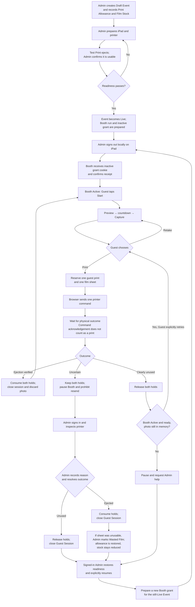

# Booth user flow after issue #9 implementation

This diagram shows the intended Admin and Guest flow defined by the [accounting, access, and provisional printer contract](superpowers/specs/2026-10-16-accounting-access-printer-contracts-design.md). It is a design view, not a description of the currently implemented app. Integrated development may use a simulated printer; real printer-backed Booth Mode and Confirmed Print accounting remain gated by the physical-ejection decision and validation in [ADR-0021](adr/0021-move-print-qualification-to-integration-checkpoint.md). The actual iPad trial is a separate release gate.

## Route map

| Step | Route |
| --- | --- |
| Admin opens the Event and chooses **Start Booth Mode** | `/events/[eventId]` — the agreed Admin entry in the [PRD](../PRD.md#enter-and-leave). |
| Server prepares the Live Event, run, and inactive grant | `POST /api/admin/events/{eventId}/booth-handoffs`. |
| Server signs out the iPad Admin session and issues the inactive Booth cookie | `POST /api/admin/booth-handoffs/{handoffId}/issue`. |
| iPad opens the guest-facing page and confirms the grant | **Proposed page route:** `/booth`; it calls `POST /api/booth/handoffs/confirm` before showing Guest actions. The guest-facing page route is not yet fixed in the PRD or implemented. |
| Pause or failed handoff requires Admin sign-in | `/sign-in`, then `/events/[eventId]` after successful same-device sign-in; the Admin explicitly selects **Resume Booth Mode**. |

An Admin pause or remote stop before reservation ends preview or review and discards the unprinted photo. A completed Capture remains counted. If reservation wins the race, the Booth run enters `PauseRequested`: new Guest work stops while the matching attempt finishes or becomes Uncertain. Event completion or cancellation waits until all Print and Film Reservations are resolved. A resumed Booth starts at welcome with a new grant; it never restores a Guest photo.
