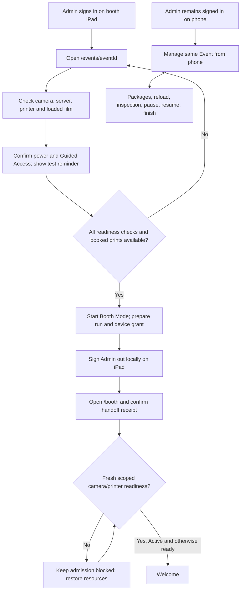
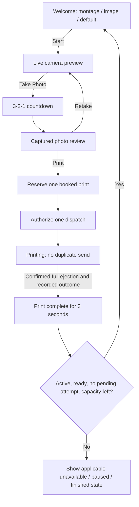
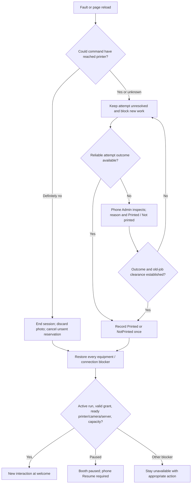
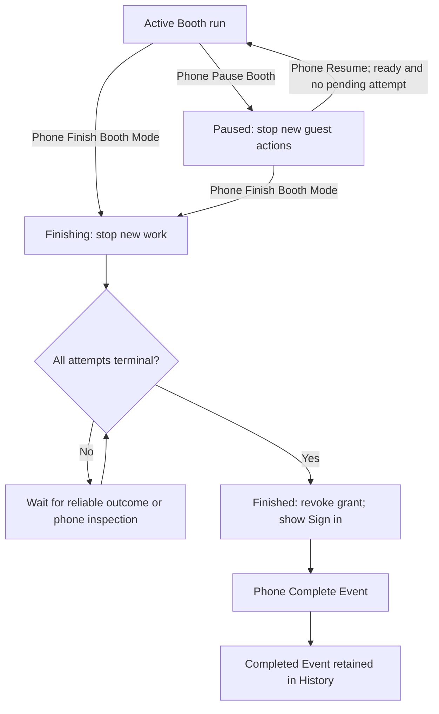

# Project routes and Booth user flow

**Current F2 scope — 2026-10-27:** [ADR-0032](adr/0032-build-full-f2-with-uploads-unavailable.md) restores full F2/#30 implementation, including the dormant media editor and private delivery, while runtime uploads remain unavailable. Preserve media sections/designs, disabled controls, trusted mutation denials, private access/retention and prior-authorized cleanup-pending safeguards. The Admin Event Media page must visibly state that interrupted/late uploads and leftover files need cleanup verification before re-enabling. Supported cleanup and enabled transfer/failure/concurrency/private-delivery/playback qualification remain required for full #30 acceptance; existing disabled-scope evidence is unchanged. F3–F8 may proceed against the verified upload-disabled F2 milestone; #30 stays in #10, remains open and is completed last as the final blocker to #10 closure.

**Approved target, 2026-10-21.** Version-2 contracts and handlers passed the #9 software checks and independent evidence review; existing Admin/Booth UI still uses legacy flows. #10 owns their integration, complete legacy removal and fresh package-only installation; its plan is approved and F1–F8 are published as #29–#36; implementation may proceed against the verified upload-disabled F2 milestone under ADR-0032; #30 stays open in #10 and is completed last before #10 closure. See [dated #9 software acceptance evidence](implementation/issue-9-package-contracts-review.md#issue-9-software-verification-passed--2026-10-25). GitHub #9 is closed as completed. Physical qualification remains open. Use the [replacement contract](superpowers/specs/2026-10-21-package-accounting-booth-recovery-design.md) for exact transitions and API shapes, and [PRD](../PRD.md) for product scope.

## Page routes

| Route                         | Who uses it                      | Purpose                                                                                                                                          |
| ----------------------------- | -------------------------------- | ------------------------------------------------------------------------------------------------------------------------------------------------ |
| `/`                           | Visitor                          | Redirect to the appropriate entry; no independent product screen                                                                                 |
| `/sign-in`                    | Admin                            | Email/password sign-in; ordinary success opens Dashboard; validated exceptional setup context may open Event detail                              |
| `/forgot-password`            | Admin                            | Neutral recovery request                                                                                                                         |
| `/auth/callback`              | Auth redirect                    | Exchange recovery code; not a navigation destination                                                                                             |
| `/reset-password`             | Admin with valid recovery link   | Change password and confirm global Admin-session revocation                                                                                      |
| `/dashboard`                  | Signed-in Admin                  | Month/upcoming/next Event and paginated activity                                                                                                 |
| `/events`                     | Signed-in Admin                  | Draft/Live list and Upcoming annotation                                                                                                          |
| `/events/new`                 | Signed-in Admin                  | Create Draft with packages and derived print total                                                                                               |
| `/events/[eventId]`           | Signed-in Admin                  | Draft editing/setup; Live management; phone packages, reload/inspection, pause/resume/finish and separate completion; terminal records read-only |
| `/history`                    | Signed-in Admin                  | Retained Completed/Cancelled Events; no redaction or deletion                                                                                    |
| `/profile`                    | Signed-in Admin                  | Phone/theme/password and local Sign out                                                                                                          |
| `/booth`                      | Device with limited grant        | Guest welcome/capture/review/printing, temporary failure recovery, paused and finished states                                                    |
| `/qualification/iphone-print` | Supervised developer/Admin trial | Existing isolated historical qualification harness; never a production Guest entry or proof of automatic completion                              |

The existing harness route is a development aid. Confirm its environment restrictions before running any physical trial. F8 must remove any legacy accounting dependencies from it, using current contracts or independent transport while retaining required calibration/proof behavior. Its dated observations remain evidence; it cannot justify keeping old product operations. No new `/stock`, `/test-print`, `/redaction` or separate guest Event-ID page belongs in the target navigation. APIs under `/api/admin/…` and `/api/booth/…` are server contracts, not pages.

Dashboard monthly Events includes nondeleted Draft, Live and Completed by venue-local scheduled start, and excludes Cancelled: four in-month Events with one Cancelled show 3. Upcoming/Next remains future Draft/Live work; [ADR-0028](adr/0028-define-monthly-event-count.md) records the distinction.

## How the Admin starts Booth Mode

Starting is an iPad setup action from `/events/[eventId]`. Remote Resume is a phone action on the same Event; it retains the valid booth grant and returns the iPad to welcome. Physical loading is separate from adding purchased packages. Initial handoff failure or genuine access expiry may need local sign-in/setup; ordinary disconnections and pause do not. Exceptional local recovery replaces access on the same unfinished run, keeps it Paused and requires explicit phone Resume. Finishing/Finished runs cannot regain guest access.

Local sign-out/navigation can release setup resources. F4's named transition test proves fresh camera/printer observations under the device grant after arrival; an Active run with stale equipment stays unavailable and any intervening pause/finish remains authoritative. See the [acceptance trace](implementation/issue-10-retirement-and-acceptance.md).

## Event Media preparation

Runtime uploads stay unavailable while the full F2 editor/private-delivery code is built dormant. Show **“Media uploads are temporarily unavailable.”** with disabled controls and persistent Admin copy even with no attached media: **“Before re-enabling uploads, verify cleanup of interrupted or late uploads and leftover files.”** No cleanup completion or re-enable action is implied. Full #30 evidence and explicit later activation remain gated by ADR-0032.

Planned enabled-media behavior: upload, replacement and removal are Draft-only, with authority, state and revision rechecked when the change commits. Accept one still JPEG/PNG/WebP background up to 10,000,000 bytes and one MP4 H.264/AVC montage up to 50,000,000 bytes with positive duration at most 30 seconds. Reject animated images and validate actual content at the trusted boundary; no conversion, trimming or editing. Failed/stale changes preserve existing media. Live media is frozen even while the Booth is Paused or Finished; Completed/Cancelled media remains retained. Playback remains silent, pausable and subject to reduced-motion fallback. See [ADR-0027](adr/0027-draft-only-event-media.md). Draft deletion keeps cleanup pending until transfer termination/drain and backend removal are proven, not just listing emptiness; [ADR-0030](adr/0030-fence-event-media-commits-and-require-cleanup-proof.md) records the current unresolved backend boundary. Retry cleanup recovers the original deletion request; cancellation keeps attached media.

## Guest flow

Retake uses no print and returns to preview for another completed shutter. Count each acknowledged Capture once. Review/Print selects the newest acknowledged shutter by `captured_at`, independent of metadata arrival order; equal timestamps permit either explicitly selected Capture. Reservation and dispatch recheck that selection. Older/tied metadata arriving after reservation does not invalidate it; a genuinely newer acknowledged shutter blocks the bound older photo, which existing unsent reconciliation settles as NotPrinted without a send or photo substitution. See [ADR-0026](adr/0026-order-captures-by-shutter-time.md). The review matches the unmirrored physical crop. At 75 seconds of capture/review inactivity show Continue; at 90 discard and return to welcome if available. A fault ends the old interaction and discards the photo; no same-photo retry after repair.

## Failure recovery

A physical send already in progress may finish; cancelling it is not guaranteed. With network loss, retain non-photo result metadata for idempotent reporting. If a reservation/dispatch response was lost, query its original receipt. A scoped reconciliation operation releases Reserved only if dispatch never committed; a competing committed dispatch remains pending. Never resend using replayed authorization. Reconnection cannot clear a pending attempt by itself.

| Failure                              | Booth message and allowed action                                                    | Phone Admin role                                                                                                 |
| ------------------------------------ | ----------------------------------------------------------------------------------- | ---------------------------------------------------------------------------------------------------------------- |
| Bluetooth                            | Bluetooth disconnected. Please inform the Admin. / **Connect to Instax** only       | Help reconnect; inspect only if outcome cannot be established                                                    |
| Camera                               | Camera disconnected. Please inform the Admin. / **Enable Camera**                   | Restore permission/live feed; during printing let outcome settle first                                           |
| Offline                              | Wi-Fi disconnected. Please inform the Admin.                                        | Restore connectivity; app rechecks server before welcome                                                         |
| Service failure, Wi-Fi cause unknown | Connection unavailable. Please inform the Admin.                                    | Resolve service issue; do not diagnose from timeout alone                                                        |
| No film, reliably established        | Printer is out of film. Please inform the Admin.                                    | Event panel: Film reload needed → load physically → Confirm film loaded                                          |
| Unknown print/other fault            | Booth is temporarily unavailable. Please inform the Admin.                          | Inspect exceptional Pending as Printed / Not printed with reason; if old job not safely cleared stay unavailable |
| All booked prints used               | All booked prints have been used. Please ask the Admin to add another Film Package. | Add whole packages; +10 each; ensure actual printer readiness                                                    |

The phone only asks Printed / Not printed when the old outcome is unknown. Loading alone never changes an old outcome, purchased capacity or confirmed total. Simultaneous faults remain separate, and recovery never overrides an explicit pause.

## Pause, finish and completion

Pause takes effect immediately but does not cancel a dispatched print; let it settle while blocking new work. A stop committed before dispatch denies it; dispatch authorized first may still eject. The iPad stays in `/booth` for Pause and Finish status. Complete Event is never a shortcut around an unresolved print. If the Event remains Live after a finished run, another run needs a new explicit local start/handoff; it keeps the same Event totals.

## Implementation and evidence

These diagrams describe the approved future flow. The current branch's simulator, old inspection/test controls and pause sign-in behavior are historical implementation, documented in [ADR-0024](adr/0024-preserve-integrated-booth-operation-boundaries.md). Hardware release requires the [proof checklist](qualification/booth-recovery-proof-checklist.md), including automatic normal completion and actual-iPad Guided Access trials.

Under [ADR-0029](adr/0029-remove-legacy-features-and-reset-development-schema.md), History contains current package Events only; existing test data is discarded during the later local rebuild. No converted-Draft booking review, old totals or compatibility screens are part of these flows.
