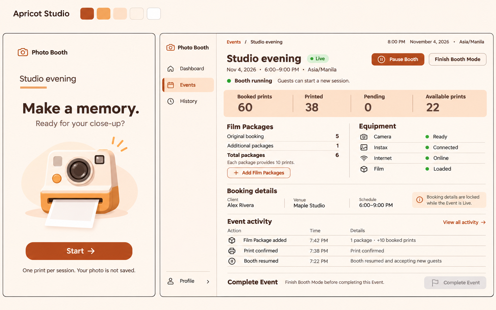

# Apricot Studio — approved visual direction

**Approved by the user: 2026-11-04. Status: visual target; application migration pending.**

The user selected the first displayed palette study (orange/Apricot Studio), including the reduced DM Sans typography, then explicitly approved it. This replaces the earlier cobalt Instant Studio proposal and the maintained Geist/teal visual direction for both Admin and Booth. [ADR-0033](../../adr/0033-adopt-apricot-studio-design-system.md) records the decision; the root [design system](../../../DESIGN_SYSTEM.md) is the exact presentation authority.

## Files and interpretation

- [Approved image](approved-direction.png): the selected welcome and Live Event study, copied unchanged from the generated source.
- [Tokens](tokens.json): exact semantic colors, typography, spacing, shape, theme assignment and motion for implementation. Dark tokens extend the selected light palette; they are not a separate approved raster.
- [Contrast checks](contrast-checks.json): calculated ratios for the documented color pairs, including text, status colors, essential boundaries and focus against its surrounding gap. This is not rendered accessibility acceptance.

The headings and buttons should use the written scale even if raster glyphs look heavier or larger. Keep touch targets generous. The camera illustration is a direction for an original bundled decorative asset; it is not a button, uploaded Event Media, retained Guest photo, printer specification or official Fujifilm identity. The board's outer title/swatches and sample clock are review presentation, not additional product UI requirements. All displayed Event data is fictional.

The illustration and cream surface belong to the default welcome. Camera/review and operational states retain a dark photographic setting using the new brown neutrals. Admin keeps its saved light/dark preference. The existing media-unavailable state, approved Guest flow and all controls continue to follow the [PRD](../../../PRD.md) and [replacement contract](../../superpowers/specs/2026-10-21-package-accounting-booth-recovery-design.md).

The [October 21 screen map](../2026-10-21-package-recovery/screen-map.md) remains useful for route, state and recovery coverage. Its images and token snapshot describe superseded styling, not a second current theme. No new full screen set or production asset extraction is implied by this approval.

## References and provenance

- [Simple Booth HALO appearance guidance](https://help.simplebooth.com/en/articles/1310875-booth-appearance-customizations): clear start presentation and photobooth context.
- [Snappic App Experience](https://help.snappic.com/en/articles/11421280-app-experience-settings): event presentation with a stable underlying workflow.
- [DM Sans](https://fonts.google.com/specimen/DM+Sans): proposed shared font family.
- [Radix palette composition](https://www.radix-ui.com/colors/docs/palette-composition/composing-a-palette): reference for separating brand, neutral and semantic roles. The Apricot colors are custom values, not an unmodified Radix scale.

Generated with the built-in Image Gen tool on 2026-11-04. Selected source filename: `exec-080ef0db-2418-41ab-92e7-00a97d84ee57.png`. Brief: preserve Instant Studio's photobooth identity and existing functionality; replace cobalt with cream/apricot/burnt orange; reduce typography to DM Sans 400/500/600 and the documented scale; show the same welcome and Admin Live Event surfaces with open sections and a modest camera illustration. The previous cobalt welcome and Admin images were attached as content references, with explicit instructions to replace their oversized type and color treatment.

No application, browser, accessibility or hardware acceptance is claimed by the image. The design system lists implementation verification requirements.
