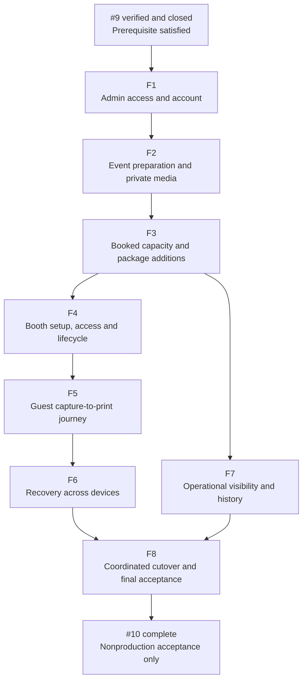
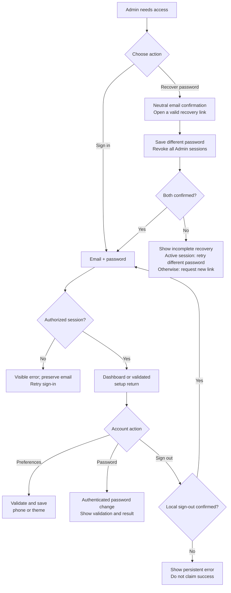
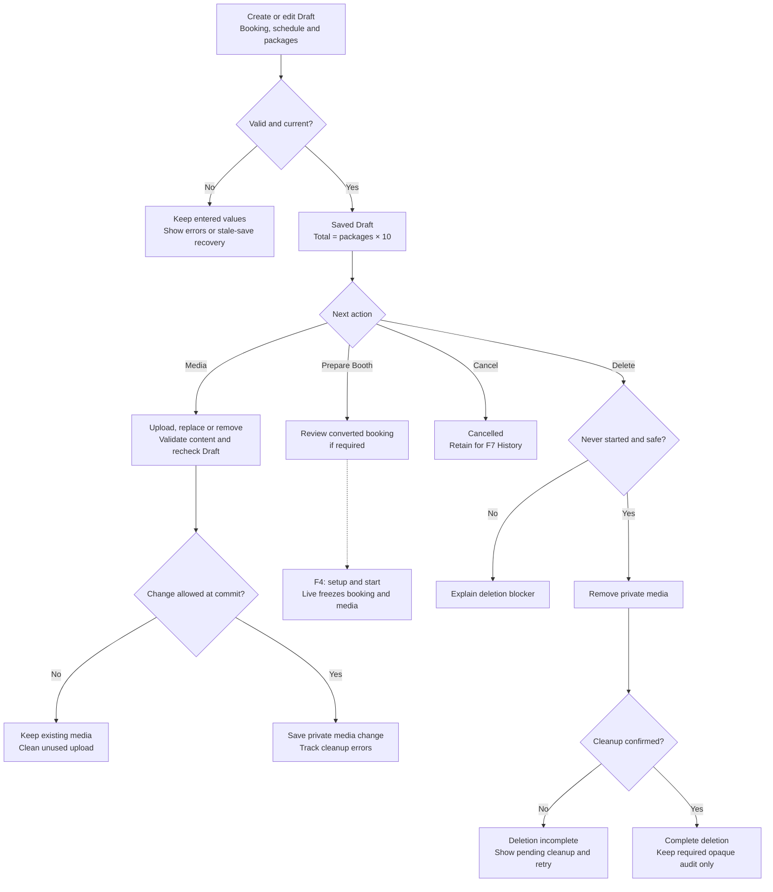
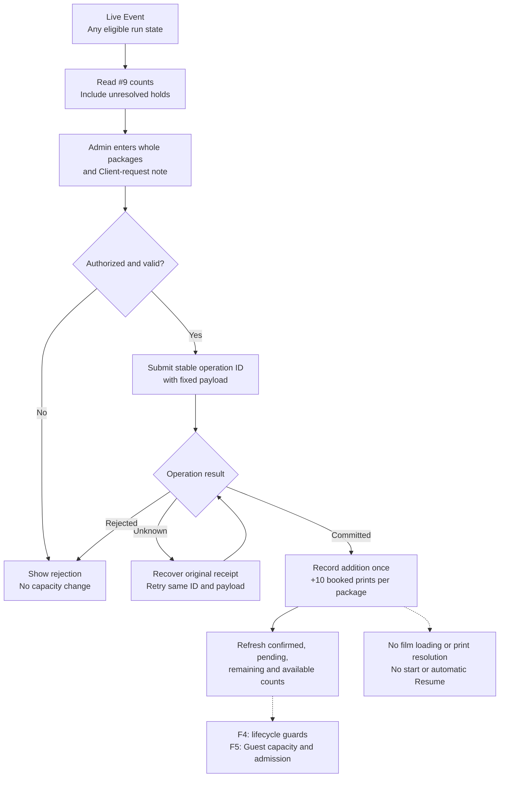
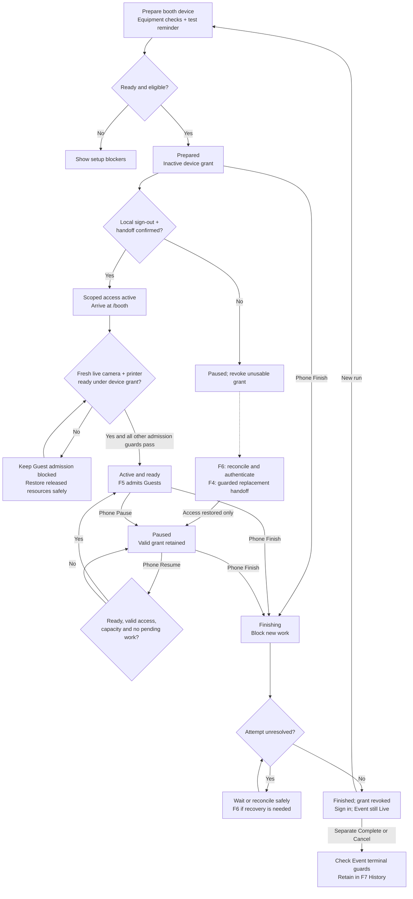
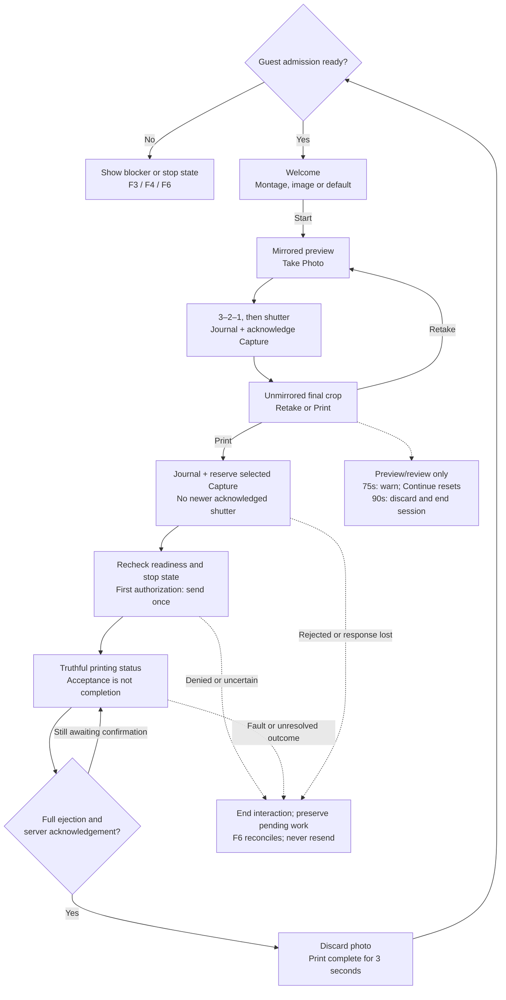
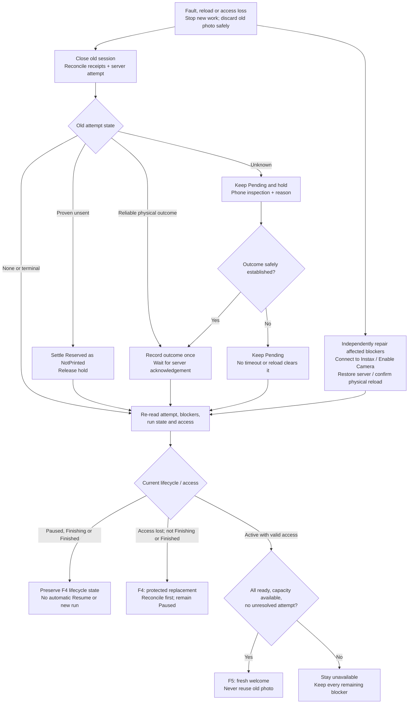
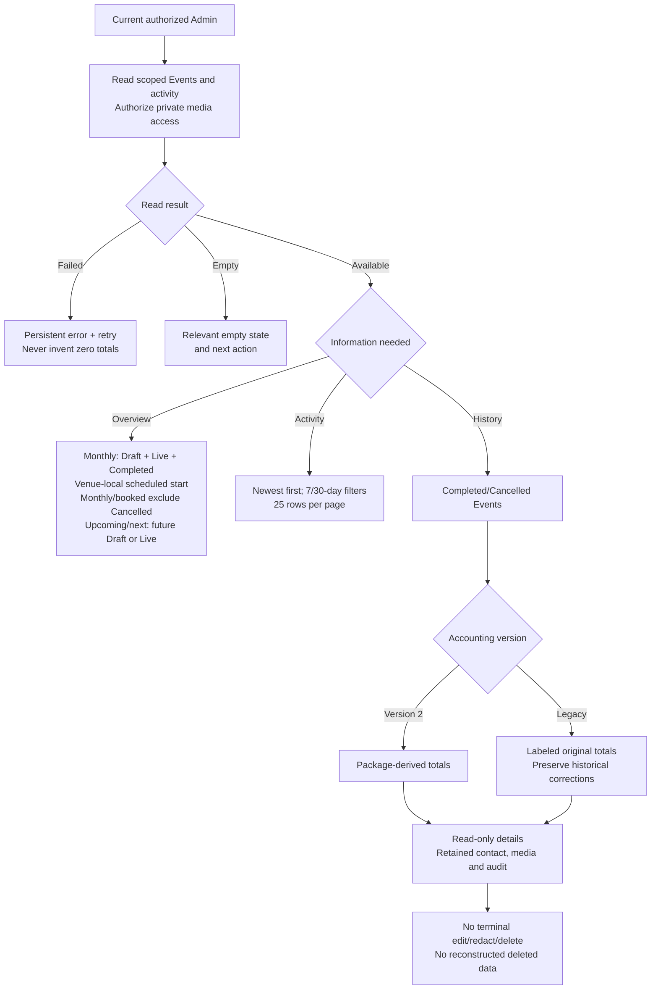
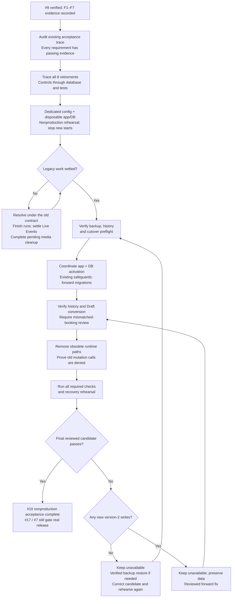
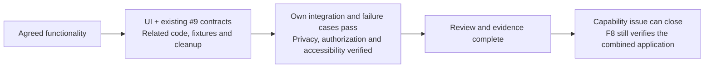

# Issue #10 — sub-issue flowcharts

**Approved design · 24 October 2026.** F1–F8 are the agreed capability groups, not GitHub issue numbers. Detailed implementation-plan approval and GitHub publication are pending. The #9 software prerequisite passed verification and independent review; #9 is closed as completed. Implementation still awaits its own plan approval/publication and the capability prerequisites below.

The [detailed implementation plans](../superpowers/plans/2026-10-24-issue-10-implementation-plan.md) were revised for review on 2026-10-25 and await approval. These charts summarize the [functional breakdown design](../superpowers/specs/2026-10-24-issue-10-functional-breakdown-design.md), including the user's monthly-count clarification. The [replacement contract](../superpowers/specs/2026-10-21-package-accounting-booth-recovery-design.md) controls detailed guards and races. Each issue includes its UI, integration, necessary data changes, legacy cleanup and tests, tracked from the start in the [acceptance trace](../implementation/issue-10-retirement-and-acceptance.md). Dashed arrows within a capability chart mark supporting behavior or a handoff to another capability.

[F1 Access](#f1-admin-access-and-account-management) · [F2 Events and media](#f2-event-preparation-and-private-media) · [F3 Capacity](#f3-booked-print-capacity-and-additional-film-packages) · [F4 Lifecycle](#f4-booth-setup-access-and-lifecycle) · [F5 Guest printing](#f5-guest-capture-to-print-journey) · [F6 Recovery](#f6-booth-recovery-across-devices) · [F7 Visibility and history](#f7-operational-visibility-and-retained-history) · [F8 Cutover](#f8-coordinated-cutover-retirement-and-final-acceptance)

## How the sub-issues fit together

Prerequisite paths are shown without redundant transitive arrows. F8 waits for **all F1–F7**. This is the approved dependency order, not permission to begin.

Real-printer qualification (#17) and the actual-iPad release gate (#7) remain separate and open. These diagrams do not move either gate into #10.

## F1. Admin access and account management

**Outcome:** the Admin can securely enter the app, recover access and manage their account.

Profile sign-out affects only that device. Password reset revokes Admin sessions globally. Neither action ends an independently valid Booth grant.

**UI references:** [Authentication](../design/2026-10-21-package-recovery/admin/08-authentication.png), [Profile](../design/2026-10-21-package-recovery/admin/10-profile.png), [feedback](../design/2026-10-21-package-recovery/admin/11-dialogs-feedback.png).

## F2. Event preparation and private media

**Outcome:** prepare a valid Draft, manage its private media and safely cancel or delete it. Draft-only changes and upload limits are approved in [ADR-0027](../adr/0027-draft-only-event-media.md).

F2 proves real interrupted/resumable transfers, malformed content, Start/Cancel races and late-upload deletion before polishing the editor. Cleanup remains pending while an upload can still create an object; the trace records actual Storage evidence.

**UI references:** [Events](../design/2026-10-21-package-recovery/admin/02-events.png), [editor](../design/2026-10-21-package-recovery/admin/03-event-editor.png), [Draft/setup](../design/2026-10-21-package-recovery/admin/04-draft-setup.png), [dialogs](../design/2026-10-21-package-recovery/admin/11-dialogs-feedback.png).

## F3. Booked print capacity and Additional Film Packages

**Outcome:** the Admin sees accurate counts and can add whole packages exactly once. Physical film loading is a different action in F6.

Available prints = `10 × (original + additional packages) − Printed − unresolved attempts`. Each unresolved attempt holds one print. F5-04 verifies exhaustion → phone package addition → a **new persisted Guest Session**, not just changed counts or welcome; F6-03 verifies that other blockers and explicit pause still prevent admission. F3 owns purchase evidence in the shared trace.

**UI references:** [Live Event](../design/2026-10-21-package-recovery/admin/05-live-event.png), [phone management](../design/2026-10-21-package-recovery/admin/06-phone-management.png), [capacity state](../design/2026-10-21-package-recovery/booth/04-printer-and-capacity.png).

## F4. Booth setup, access and lifecycle

**Outcome:** safely start, pause, resume and finish a Booth run, then complete/cancel the Event separately.

The phone's Admin session survives the initial handoff. F4-01 proves local Admin access ends, scoped access activates and fresh readiness is established after navigation, including setup-resource cleanup and denied reacquisition. The freshness check gates admission; it adds no run state, and rechecks intervening Pause/Finish. Pause/Finish before dispatch denies the send; dispatch authorized first may still print and must settle. Equipment recovery never overrides Pause or Finish. Replacement is refused while an old print may still deliver and for Finishing/Finished runs; successful replacement activates access only and stays Paused.

**UI references:** [Setup](../design/2026-10-21-package-recovery/admin/04-draft-setup.png), [phone lifecycle](../design/2026-10-21-package-recovery/admin/06-phone-management.png), [Booth lifecycle/access](../design/2026-10-21-package-recovery/booth/05-pause-finish-access.png).

## F5. Guest capture-to-print journey

**Outcome:** one reviewed photo produces at most one authorized send, with truthful completion and no stored Guest image.

Equal shutter timestamps allow the explicitly selected Capture; dispatch rechecks its eligibility. The last reserved print can dispatch at zero available because it owns its hold. Countdown/printing have no Guest inactivity timer. All phases stop safely on faults; photo disposal waits only for an authorized transport still using its bytes. After exhaustion, F3 adds packages and F5 rechecks all admission conditions.

**UI references:** [Welcome/capture](../design/2026-10-21-package-recovery/booth/01-welcome-capture.png), [review/printing/completion](../design/2026-10-21-package-recovery/booth/02-review-printing-complete.png), [capacity](../design/2026-10-21-package-recovery/booth/04-printer-and-capacity.png).

## F6. Booth recovery across devices

**Outcome:** restore safe operation without resending an old photo, guessing an outcome or clearing an Admin stop.

Repair and outcome resolution proceed independently; **both must be safe before new Guest work**. A missing receipt alone never proves an attempt is absent. Inspected **Printed** requires full ejection, even if unusable; **Not printed** requires no ejection **and no possible later output from the old job**. Reloading changes neither booked capacity nor the old outcome. A camera fault during printing blocks the next Guest while the attempt settles.

**UI references:** [Phone recovery](../design/2026-10-21-package-recovery/admin/07-phone-recovery.png), [connection recovery](../design/2026-10-21-package-recovery/booth/03-connection-recovery.png), [printer/capacity](../design/2026-10-21-package-recovery/booth/04-printer-and-capacity.png), [access/lifecycle](../design/2026-10-21-package-recovery/booth/05-pause-finish-access.png), [paired iPad/phone journey](../design/2026-10-21-package-recovery/journeys/01-ipad-phone-recovery.png).

## F7. Operational visibility and retained history

**Outcome:** the Admin can understand upcoming work, recent activity and retained Event records with accurate accounting.

Four in-month Events with one Cancelled show **3**; Completed still counts and deleted Drafts do not. See [ADR-0028](../adr/0028-define-monthly-event-count.md) and trace F7-01. The owning functionality records each audit event; F7 reads and presents it. History never contains saved Guest photos.

**UI references:** [Dashboard](../design/2026-10-21-package-recovery/admin/01-dashboard.png), [History](../design/2026-10-21-package-recovery/admin/09-history.png), [Event detail/activity](../design/2026-10-21-package-recovery/admin/05-live-event.png).

## F8. Coordinated cutover, retirement and final acceptance

**Outcome:** the complete version-2 application and migration pass nonproduction acceptance, with history preserved and obsolete writes denied.

The eight retirements are editable Print Allowance, individual Additional Prints, shared Film Stock, Wasted Film/quality refunds, in-app Test Print, Client Redaction/past-Event deletion, superseded recovery/local takeover, and temporary compatibility code. Each capability supplies its own cleanup; F8 proves the coordinated result. Applied migrations, required historical readers and audit evidence remain.

**UI reference:** [complete approved gallery](../design/2026-10-21-package-recovery/index.html), especially the [paired recovery journey](../design/2026-10-21-package-recovery/journeys/01-ipad-phone-recovery.png). F8 introduces no new product screen.

## What closes each issue

These are scope and behavior diagrams, not new state-machine contracts or a claim that any functionality is implemented. The [screen map](../design/2026-10-21-package-recovery/screen-map.md) and [design system](../../DESIGN_SYSTEM.md) remain the presentation authorities.
