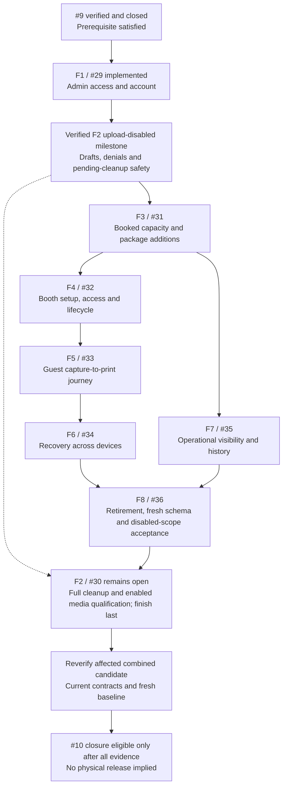
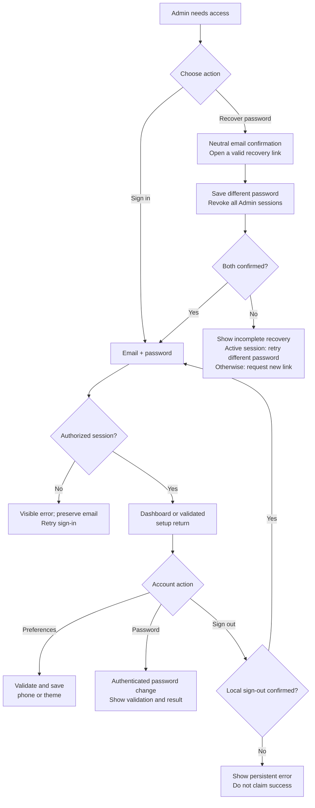
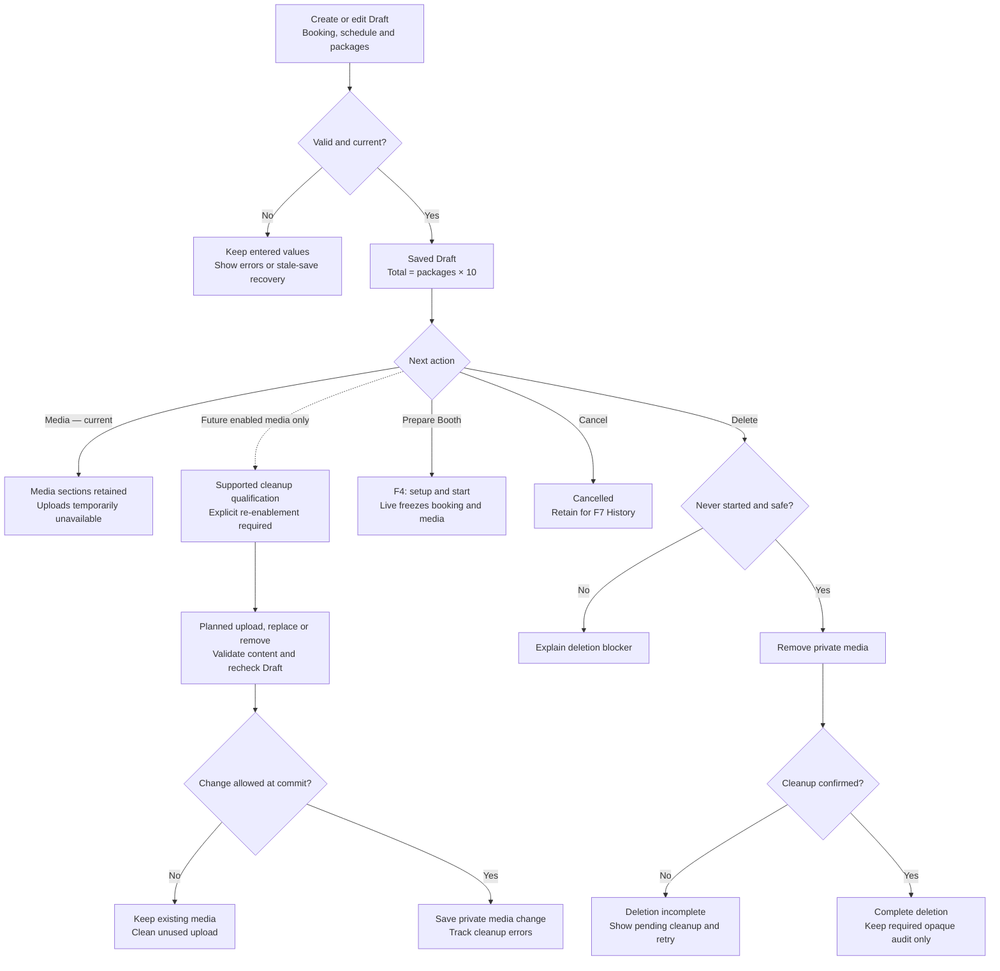
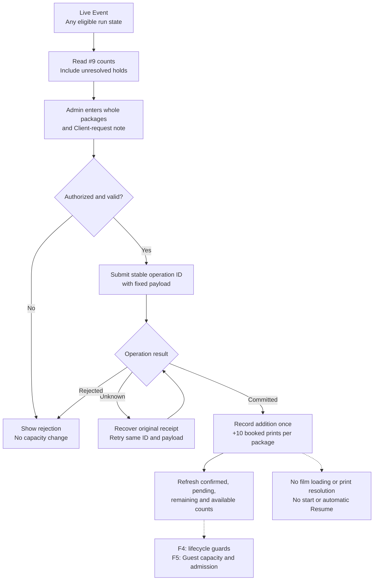
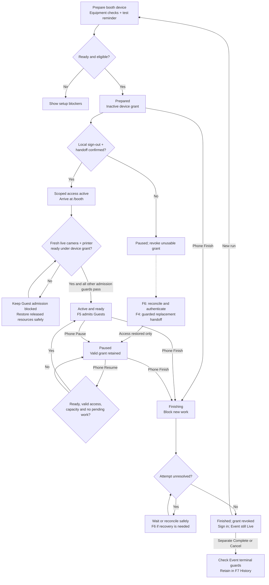
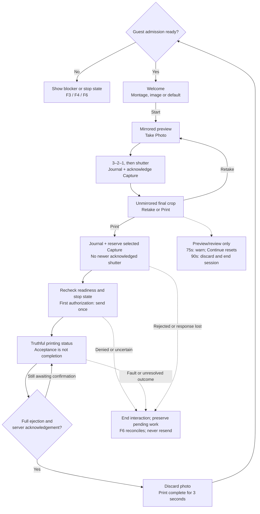
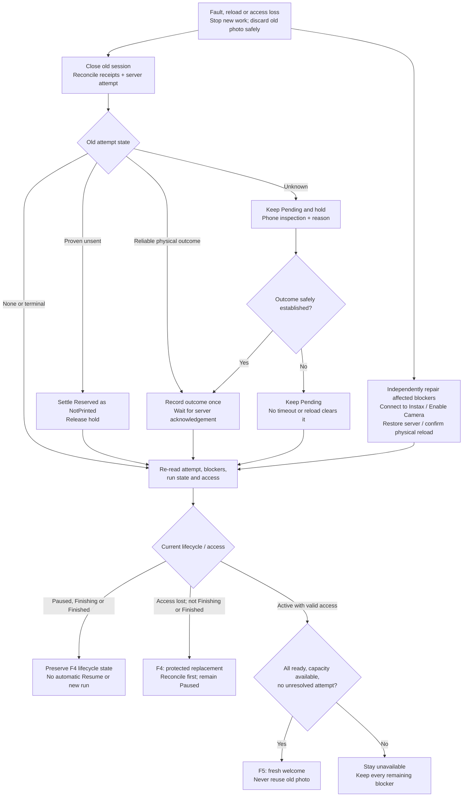
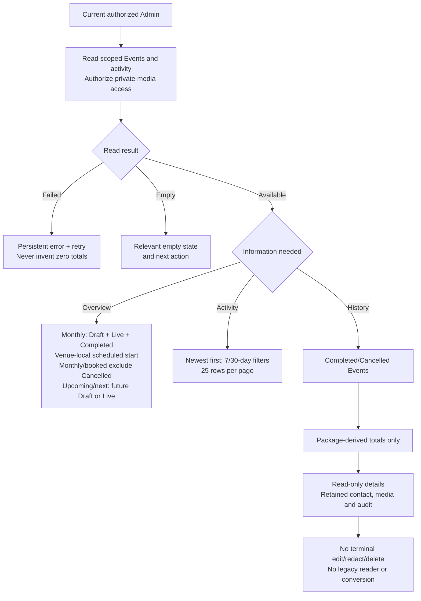
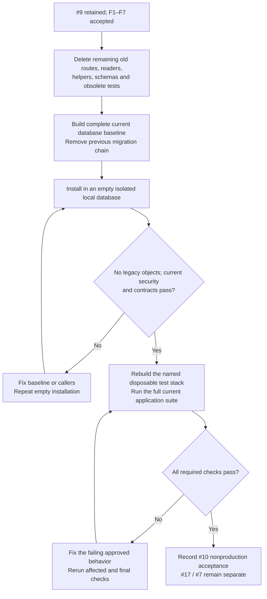
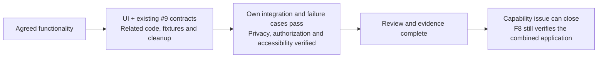

# Issue #10 — sub-issue flowcharts

**2026-10-27 F2 scope:** [ADR-0032](../adr/0032-build-full-f2-with-uploads-unavailable.md) restores full dormant F2/#30 editor/private-delivery implementation while runtime uploads remain unavailable. Keep trusted denials, media designs, the visible Admin cleanup reminder and prior-authorized deletion pending. Full cleanup and enabled transfer/failure/concurrency/private-delivery/playback proof remain required for #30 completion. F3–F8 may proceed against the verified upload-disabled F2 milestone; #30 remains open in #10 and is completed last as its final closure blocker. these diagrams do not change native dependencies or claim acceptance.

**Approved design · 24 October 2026.** F1–F8 are the agreed capability groups, now published as GitHub #29–#36. The detailed plans were approved on 2026-10-25, committed as `0bd7503` and published under your later instruction. F1 is implemented; full dormant F2 implementation is authorized under ADR-0032 with uploads unavailable under ADR-0031; F3–F8 may proceed against the verified upload-disabled F2 milestone; #30 stays in #10, remains open and is completed last as the final blocker to #10 closure. The #9 software prerequisite passed verification and independent review; #9 is closed as completed. Capability prerequisites below still apply.

For your review only, revised 2026-10-25 for complete legacy removal. Each chart shows user behavior. Agents use the written contracts and capability plans; these diagrams are not additional work orders. The diagrams claim no new implementation evidence or fresh database install.

## How the sub-issues fit together

Prerequisite paths are shown without redundant transitive arrows. F3–F8 consume the verified upload-disabled F2 milestone; F8 requires F1 and F3–F7 acceptance plus that milestone. Full #30 remains open in #10 and is completed last before parent closure. These are current execution boundaries, not a tracker read-back or passing evidence.

Real-printer qualification (#17) and the actual-iPad release gate (#7) remain separate and open. These diagrams do not move either gate into #10.

## F1. Admin access and account management

**Outcome:** the Admin can securely enter the app, recover access and manage their account.

Profile sign-out affects only that device. Password reset revokes Admin sessions globally. Neither action ends an independently valid Booth grant.

## F2. Event preparation and private media

**Current outcome:** prepare a valid Draft, retain media sections with uploads unavailable and safely cancel or delete it. The future enabled-media path preserves ADR-0027's Draft-only changes and upload limits.

F2 preserves media sections with unavailable feedback and trusted upload/attachment/replacement denial now. The planned enabled feature still needs real interrupted/resumable transfers, malformed-content/lifecycle races and supported cleanup proof before re-enablement. Cleanup remains pending while an upload can still create an object; the trace records actual Storage evidence.

## F3. Booked print capacity and Additional Film Packages

**Outcome:** the Admin sees accurate counts and can add whole packages exactly once. Physical film loading is a different action in F6.

Available prints = `10 × (original + additional packages) − Printed − unresolved attempts`. Each unresolved attempt holds one print. F5-04 verifies exhaustion → phone package addition → a **new persisted Guest Session**, not just changed counts or welcome; F6-03 verifies that other blockers and explicit pause still prevent admission. F3 owns purchase evidence in the shared trace.

## F4. Booth setup, access and lifecycle

**Outcome:** safely start, pause, resume and finish a Booth run, then complete/cancel the Event separately.

The phone's Admin session survives the initial handoff. F4-01 proves local Admin access ends, scoped access activates and fresh readiness is established after navigation, including setup-resource cleanup and denied reacquisition. The freshness check gates admission; it adds no run state, and rechecks intervening Pause/Finish. Pause/Finish before dispatch denies the send; dispatch authorized first may still print and must settle. Equipment recovery never overrides Pause or Finish. Replacement is refused while an old print may still deliver and for Finishing/Finished runs; successful replacement activates access only and stays Paused.

## F5. Guest capture-to-print journey

**Outcome:** one reviewed photo produces at most one authorized send, with truthful completion and no stored Guest image.

Equal shutter timestamps allow the explicitly selected Capture; dispatch rechecks its eligibility. The last reserved print can dispatch at zero available because it owns its hold. Countdown/printing have no Guest inactivity timer. All phases stop safely on faults; photo disposal waits only for an authorized transport still using its bytes. After exhaustion, F3 adds packages and F5 rechecks all admission conditions.

## F6. Booth recovery across devices

**Outcome:** restore safe operation without resending an old photo, guessing an outcome or clearing an Admin stop.

Repair and outcome resolution proceed independently; **both must be safe before new Guest work**. A missing receipt alone never proves an attempt is absent. Inspected **Printed** requires full ejection, even if unusable; **Not printed** requires no ejection **and no possible later output from the old job**. Reloading changes neither booked capacity nor the old outcome. A camera fault during printing blocks the next Guest while the attempt settles.

## F7. Operational visibility and retained history

**Outcome:** the Admin can understand upcoming work, recent activity and retained Event records with accurate accounting.

Four in-month Events with one Cancelled show **3**; Completed still counts and deleted Drafts do not. The owning functionality records each audit event; F7 reads and presents it. History never contains saved Guest photos.

## F8. Complete removal, fresh installation and final acceptance

**Outcome:** all legacy code/schema is gone and the current application passes on a fresh package-only database.

There is no old-data import, old-run settlement, legacy snapshot, Draft conversion/review or legacy History reader. Existing development/test data is disposable. The reset is a development setup operation with test apps stopped and physical printers disconnected, never a way to dismiss a real uncertain print. Current package History and runtime print holds remain safe.

## What closes each issue

These are scope and behavior diagrams, not new state-machine contracts or fresh implementation evidence. The written spec and plans remain the implementation authorities.
