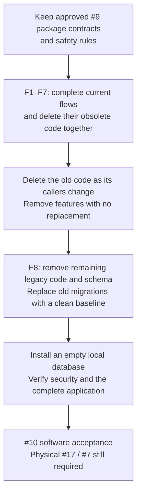
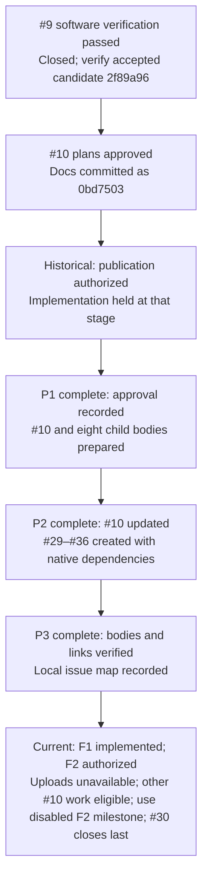

# Issue #10 — implementation task flowchart

**2026-10-27 F2 scope:** [ADR-0032](../adr/0032-build-full-f2-with-uploads-unavailable.md) restores full dormant F2/#30 editor/private-delivery implementation while runtime uploads remain unavailable. Keep trusted denials, media designs, the visible Admin cleanup reminder and prior-authorized deletion pending. Full cleanup and enabled transfer/failure/concurrency/private-delivery/playback proof remain required for #30 completion. F3–F8 may proceed against the verified upload-disabled F2 milestone; #30 remains open in #10 and is completed last as its final closure blocker. These diagrams do not change native dependencies or claim acceptance.

**Original 23-task breakdown across eight capability plans.** This is a visual index of the plans revised on 25 October 2026, not a new plan or a completion record. The plan is approved and F1–F8 are published as #29–#36. F1 is implemented; full dormant F2 implementation is authorized under ADR-0032 with uploads unavailable under ADR-0031; F3–F8 may proceed against the verified upload-disabled F2 milestone; #30 stays in #10, remains open and is completed last as the final blocker to #10 closure. #9's software prerequisite is already satisfied.

For your review only. This shows the work order and what disappears; agents use the detailed plans, not this chart. This chart records no new implementation evidence or database reset. The approved documentation was committed as `0bd7503`. You then authorized publication and its verification; that is complete. That publication-stage hold was later superseded: F1 is implemented, dormant full F2 work is authorized with uploads unavailable, and F3–F8 may proceed using the verified disabled F2 milestone and their other prerequisites. #30 remains open under #10 and finishes last before parent closure.

## The change you approved

There is no legacy-data migration, old-Draft conversion or legacy History screen. Existing data is disposable test data. Current package History, safe Draft deletion, privacy and printer safety stay.

## Publication history and current authorization

P1–P3 publication tasks are complete. The original implementation tasks below are a scope index, not all pending: F1 is implemented and the current F2 scope is authorized. Approval/publication alone did not authorize application implementation; later instructions authorized F1/F2 and continuation of other #10 work with uploads unavailable. #30 remains open in #10 and is completed last before #10 closure.

## All implementation tasks

Each task includes its planned implementation, focused verification and commit. F3–F8 consume the verified upload-disabled F2 milestone; other capability prerequisites require recorded acceptance. F7 can follow F3 alongside the F4–F6 sequence. F8 may complete its disabled-scope acceptance after F1/F3–F7 and the F2 milestone; full #30 finishes last before parent closure. The arrows express dependencies, not a request to delegate work.

```mermaid
flowchart TD
  START["F1 implemented; current F2 scope authorized<br/>Other #10 work eligible; use disabled F2 milestone; #30 closes last"]

  subgraph F1["F1 / #29 — Admin access and account management"]
    F1T1["F1.T1: Sign-in and truthful<br/>password recovery"]
    F1T2["F1.T2: Profile edits and<br/>current-device sign-out"]
    F1T3["F1.T3: Shared navigation and<br/>accessible account presentation"]
    F1T1 --> F1T2 --> F1T3
  end

  subgraph F2["F2 / #30 — Event preparation and private media"]
    F2T1["F2.T1: Package-based Draft<br/>preparation and discovery"]
    F2T2["F2.T2/4B: Dormant editor, validated writes<br/>and authorized private delivery"]
    F2T3["F2.T3: Retain verified safe cancellation,<br/>no-authorization deletion and cleanup pending"]
    F2T4["F2.T4A: Preserved media sections<br/>uploads unavailable; trusted denial"]
    F2T1 --> F2T3 --> F2T4
    F2FULL["Full #30: supported cleanup and enabled<br/>transfer/failure/concurrency/delivery/playback proof"]
    F2T2 -.-> F2FULL
  end

  subgraph F3["F3 / #31 — Booked capacity and Additional Film Packages"]
    F3T1["F3.T1: Replace allowance and stock reads<br/>with package counts"]
    F3T2["F3.T2: Whole-package purchase<br/>and receipt recovery"]
    F3T1 --> F3T2
  end

  subgraph F4["F4 / #32 — Booth setup, access and lifecycle"]
    F4T1["F4.T1: Equipment setup and<br/>initial scoped handoff"]
    F4T2["F4.T2: Run state and<br/>phone Pause, Resume and Finish"]
    F4T3["F4.T3: Replacement access,<br/>new runs and Event termination"]
    F4T1 --> F4T2 --> F4T3
  end

  subgraph F5["F5 / #33 — Guest capture-to-print journey"]
    F5T1["F5.T1: Welcome, camera and<br/>acknowledged Capture selection"]
    F5T2["F5.T2: One-send dispatch<br/>and truthful completion"]
    F5T3["F5.T3: Inactivity, immediate fault stops<br/>and capacity recovery admission"]
    F5T1 --> F5T2 --> F5T3
  end

  subgraph F6["F6 / #34 — Booth recovery across devices"]
    F6T1["F6.T1: Receipt and server reconciliation<br/>after fault or reload"]
    F6T2["F6.T2: Independent equipment repair,<br/>reload and inspection"]
    F6T3["F6.T3: Exceptional access recovery<br/>and combined-device acceptance"]
    F6T1 --> F6T2 --> F6T3
  end

  subgraph F7["F7 / #35 — Operational visibility and retained history"]
    F7T1["F7.T1: Dashboard summaries<br/>and activity"]
    F7T2["F7.T2: Package-only History and read-only detail<br/>Remove old readers"]
    F7T1 --> F7T2
  end

  ACCEPTED["F1 and F3–F7 accepted<br/>Verified disabled F2 milestone retained"]

  subgraph F8["F8 / #36 — Complete removal and fresh installation"]
    F8T1["F8.T1: Trace and delete<br/>all remaining legacy application paths"]
    F8T2["F8.T2: Replace the old migration chain<br/>Prove a fresh package-only installation"]
    F8T3["F8.T3: Verify disabled candidate<br/>and record F8 acceptance; #30 remains open"]
    F8T1 --> F8T2 --> F8T3
  end

  DONE["#10 nonproduction software acceptance recorded<br/>Issue closure requires a later instruction"]

  START --> F1T1
  F1T3 --> F2T1
  F2T4 --> F3T1
  F3T2 --> F4T1
  F4T3 --> F5T1
  F5T3 --> F6T1
  F3T2 --> F7T1
  F6T3 --> ACCEPTED
  F7T2 --> ACCEPTED
  ACCEPTED --> F8T1
  F8T3 --> F2FULL
  F2FULL --> RECHECK["Reverify affected combined candidate<br/>Current contracts and fresh baseline"]
  RECHECK --> DONE
```

## What disappears and what stays

| Area                                      | End of #10                                                                          |
| ----------------------------------------- | ----------------------------------------------------------------------------------- |
| Editable Print Allowance                  | Removed; original packages determine capacity                                       |
| Individual Additional Prints              | Removed; whole Additional Film Packages remain                                      |
| Shared Film Stock and Wasted Film refunds | Removed; physical readiness and confirmed-ejection counting remain                  |
| In-app Test Print and its setup gate      | Removed; independent physical testing reminder remains                              |
| Client Redaction and past-Event deletion  | Removed; safe never-started Draft deletion remains                                  |
| Old recovery/local takeover               | Removed; current Booth recovery and exceptional protected access replacement remain |
| Old History and Draft conversion          | Removed; new package-model terminal History remains                                 |
| Old migrations and database objects       | Replaced by a complete verified package-only baseline                               |
| #9 contracts and evidence                 | Current behavior retained and reverified; dated acceptance preserved                |

F2 can build its full editor/private delivery dormant now with the unavailable sections and cleanup reminder retained; full enabled transfer/failure/concurrency/validation/deletion/delivery/playback proof remains required for #30 acceptance and later explicit re-enablement. F4 proves fresh equipment readiness after handoff. F5/F6 prove new Guest admission after a package purchase without clearing other blockers or a pause. F7 keeps the approved monthly count: Draft + Live + Completed, excluding Cancelled.

These charts are a review aid, not a test result or an instruction to deploy. Real-printer qualification remains #17; actual-iPad release remains #7. Both remain outside #10 software acceptance.
