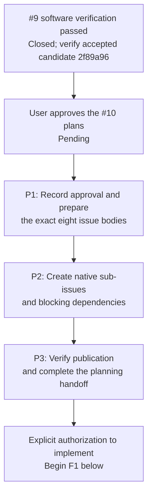

# Issue #10 — implementation task flowchart

**23 implementation tasks across eight capability plans.** This is a visual index of the plans revised on 25 October 2026, not a new plan or a completion record. Plan approval and publication remain pending; #9's software prerequisite is already satisfied.

The [main plan](../superpowers/plans/2026-10-24-issue-10-implementation-plan.md) defines execution details and environments. The [approved functional design](../superpowers/specs/2026-10-24-issue-10-functional-breakdown-design.md) defines scope; the [capability flowcharts](issue-10-functional-breakdown.md) show user behavior. Task numbers below match the eight linked plans exactly.

## Before implementation

P1–P3 are publication tasks, separate from the 23 implementation tasks. Approval/publication does not itself authorize application implementation.

## All implementation tasks

Each task includes its planned implementation, focused verification and commit. Cross-capability arrows require the preceding capability's acceptance and recorded evidence. Redundant transitive arrows are omitted: F7 can follow F3 alongside the F4–F6 sequence, and F8 waits for **all F1–F7**. The arrows express dependencies, not a request to delegate work.

```mermaid
flowchart TD
  START["Approval, publication and<br/>implementation authorization satisfied"]

  subgraph F1["F1 — Admin access and account management"]
    F1T1["F1.T1: Sign-in and truthful<br/>password recovery"]
    F1T2["F1.T2: Profile edits and<br/>current-device sign-out"]
    F1T3["F1.T3: Shared navigation and<br/>accessible account presentation"]
    F1T1 --> F1T2 --> F1T3
  end

  subgraph F2["F2 — Event preparation and private media"]
    F2T1["F2.T1: Package-based Draft<br/>preparation and discovery"]
    F2T2["F2.T2: Validated, immutable<br/>private media writes"]
    F2T3["F2.T3: Safe Draft cancellation,<br/>deletion and cleanup"]
    F2T4["F2.T4: Upload, replacement and removal UI<br/>with authorized delivery"]
    F2T1 --> F2T2 --> F2T3 --> F2T4
  end

  subgraph F3["F3 — Booked capacity and Additional Film Packages"]
    F3T1["F3.T1: Replace allowance and stock reads<br/>with package counts"]
    F3T2["F3.T2: Whole-package purchase<br/>and receipt recovery"]
    F3T1 --> F3T2
  end

  subgraph F4["F4 — Booth setup, access and lifecycle"]
    F4T1["F4.T1: Equipment setup and<br/>initial scoped handoff"]
    F4T2["F4.T2: Run state and<br/>phone Pause, Resume and Finish"]
    F4T3["F4.T3: Replacement access,<br/>new runs and Event termination"]
    F4T1 --> F4T2 --> F4T3
  end

  subgraph F5["F5 — Guest capture-to-print journey"]
    F5T1["F5.T1: Welcome, camera and<br/>acknowledged Capture selection"]
    F5T2["F5.T2: One-send dispatch<br/>and truthful completion"]
    F5T3["F5.T3: Inactivity, immediate fault stops<br/>and capacity recovery admission"]
    F5T1 --> F5T2 --> F5T3
  end

  subgraph F6["F6 — Booth recovery across devices"]
    F6T1["F6.T1: Receipt and server reconciliation<br/>after fault or reload"]
    F6T2["F6.T2: Independent equipment repair,<br/>reload and inspection"]
    F6T3["F6.T3: Exceptional access recovery<br/>and combined-device acceptance"]
    F6T1 --> F6T2 --> F6T3
  end

  subgraph F7["F7 — Operational visibility and retained history"]
    F7T1["F7.T1: Dashboard summaries<br/>and activity"]
    F7T2["F7.T2: Retained History<br/>and immutable Event detail"]
    F7T1 --> F7T2
  end

  ACCEPTED["All F1–F7 accepted<br/>Owner evidence recorded"]

  subgraph F8["F8 — Coordinated cutover and final acceptance"]
    F8T1["F8.T1: Retirement inventory<br/>and final runtime removal"]
    F8T2["F8.T2: Rehearse committed activation,<br/>preservation and failure recovery"]
    F8T3["F8.T3: Verify the complete candidate<br/>and record #10 acceptance"]
    F8T1 --> F8T2 --> F8T3
  end

  DONE["#10 nonproduction software acceptance recorded<br/>Issue closure requires a later instruction"]

  START --> F1T1
  F1T3 --> F2T1
  F2T4 --> F3T1
  F3T2 --> F4T1
  F4T3 --> F5T1
  F5T3 --> F6T1
  F3T2 --> F7T1
  F6T3 --> ACCEPTED
  F7T2 --> ACCEPTED
  ACCEPTED --> F8T1
  F8T3 --> DONE
```

## Task sources and full prerequisites

All capabilities reuse the accepted #9 contracts. Each plan contains the exact files, interfaces, acceptance cases and commands for its tasks.

| Capability plan                                                                                                       | Tasks | Prerequisites besides #9 |
| --------------------------------------------------------------------------------------------------------------------- | ----- | ------------------------ |
| [F1 — Admin access and account management](../superpowers/plans/2026-10-24-issue-10-f1-admin-access.md)               | T1–T3 | None                     |
| [F2 — Event preparation and private media](../superpowers/plans/2026-10-24-issue-10-f2-event-preparation-media.md)    | T1–T4 | F1                       |
| [F3 — Booked capacity and Additional Film Packages](../superpowers/plans/2026-10-24-issue-10-f3-package-capacity.md)  | T1–T2 | F2                       |
| [F4 — Booth setup, access and lifecycle](../superpowers/plans/2026-10-24-issue-10-f4-booth-lifecycle.md)              | T1–T3 | F1, F2, F3               |
| [F5 — Guest capture-to-print journey](../superpowers/plans/2026-10-24-issue-10-f5-guest-printing.md)                  | T1–T3 | F2, F4                   |
| [F6 — Booth recovery across devices](../superpowers/plans/2026-10-24-issue-10-f6-booth-recovery.md)                   | T1–T3 | F3, F4, F5               |
| [F7 — Operational visibility and retained history](../superpowers/plans/2026-10-24-issue-10-f7-visibility-history.md) | T1–T2 | F2, F3                   |
| [F8 — Coordinated cutover and final acceptance](../superpowers/plans/2026-10-24-issue-10-f8-cutover-acceptance.md)    | T1–T3 | All F1–F7                |

## Execution checks carried through the flow

| Owner                                      | Required proof                                                                                                                                                                                                                                                                                                                           |
| ------------------------------------------ | ---------------------------------------------------------------------------------------------------------------------------------------------------------------------------------------------------------------------------------------------------------------------------------------------------------------------------------------- |
| Every capability; F8.T3 audits             | Populate the existing [acceptance trace](../implementation/issue-10-retirement-and-acceptance.md#acceptance-trace) with actual revision, command, environment and evidence as work completes. Evidence is currently pending.                                                                                                             |
| All browser tasks; F8.T2 cutover isolation | Follow the [command/environment table](../superpowers/plans/2026-10-24-issue-10-implementation-plan.md#verification-and-environment-rules). Keep the ordinary production-build suite, development simulator suites and disposable cutover app/database separate. Add the cutover config and default exclusion before executing its test. |
| F2.T2 → F2.T3 → F2.T4                      | Prove real interrupted/resumable uploads, invalid content, Start/Cancel races and late-upload deletion cleanup before polishing the editor. Failed mechanics block dependent editor work.                                                                                                                                                |
| F4.T1                                      | Prove setup succeeds, local Admin access ends, scoped Booth access activates and fresh camera/printer readiness is established after navigation to `/booth`, before Guest admission.                                                                                                                                                     |
| F3.T2 → F5.T3; F6.T3 blocked variants      | Prove purchase adds capacity exactly once, then admits a newly persisted Guest Session after exhaustion. Purchase must preserve pause and independent blockers.                                                                                                                                                                          |
| F7.T1                                      | Monthly totals count Draft, Live and Completed Events scheduled in the venue-local current month; exclude Cancelled and deleted Events. One Event in each state yields **3**.                                                                                                                                                            |
| F8.T1 → F8.T2                              | Prepare runtime retirement, but settle legacy work with the old application before applying the coordinated switch. Rehearse backup restoration before application v2 writes and forward recovery after them, only in the disposable environment.                                                                                        |

Real-printer automatic ejection/recovery qualification remains **#17**; the actual-iPad release gate remains **#7**. Both stay open and outside #10's implementation tasks. This flowchart authorizes no production activation or physical printing.
