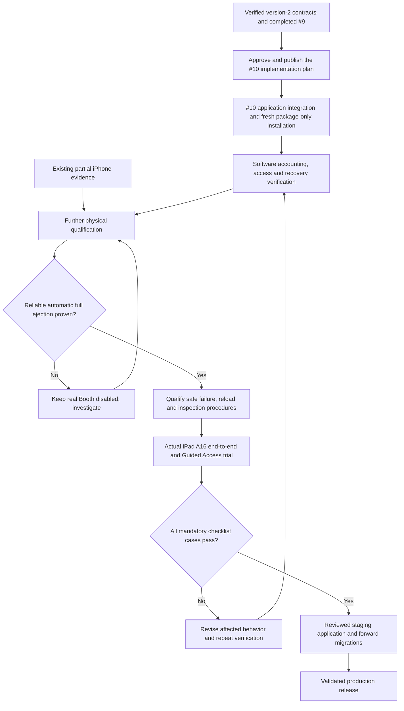

# Development, qualification and release flow

**Current target:** [ADR-0025](../adr/0025-package-accounting-and-booth-recovery.md), approved 2026-10-21. Version-2 contracts and handlers passed #9 software verification, and #9 is closed as completed. #10's plan is approved; F1–F8 are published as #29–#36; F1 is implemented; dormant full F2 work is authorized with runtime uploads unavailable under ADR-0032. F3–F8 may proceed against the verified upload-disabled F2 milestone and their other prerequisites; #30 stays open in #10 and is completed last as the final blocker to parent closure. Hosted activation and physical qualification remain open.

Automatic normal completion is mandatory. Phone Printed / Not printed is exceptional recovery; it cannot replace automatic completion on every print. Reliable automatic reload detection is optional: physical reload plus phone confirmation is the approved fallback after its procedure passes qualification. Printer count is never physical inventory or booked capacity.

The [proof checklist](../qualification/booth-recovery-proof-checklist.md) names evidence, acceptance criteria and fallbacks. The [dated #17 report](../qualification/issue-17-trial-report.md) preserves observations without claiming the new flow passed. [Guest/phone route flow](../booth-user-flow.md) shows the approved target experience.

GitHub #9 completed contract fixes and verification; #10 owns complete application integration, complete legacy removal and fresh installation and nonproduction acceptance; #17 owns real-printer qualification; #7 owns actual-iPad release validation. The [publication record](../github-issue-update-drafts.md) distinguishes accepted #9, the published #10 removal scope and F1–F8 links, and unpublished #17/#7 drafts. Description publication does not close an issue, and #10 completion does not authorize real-printer enablement or production launch.
