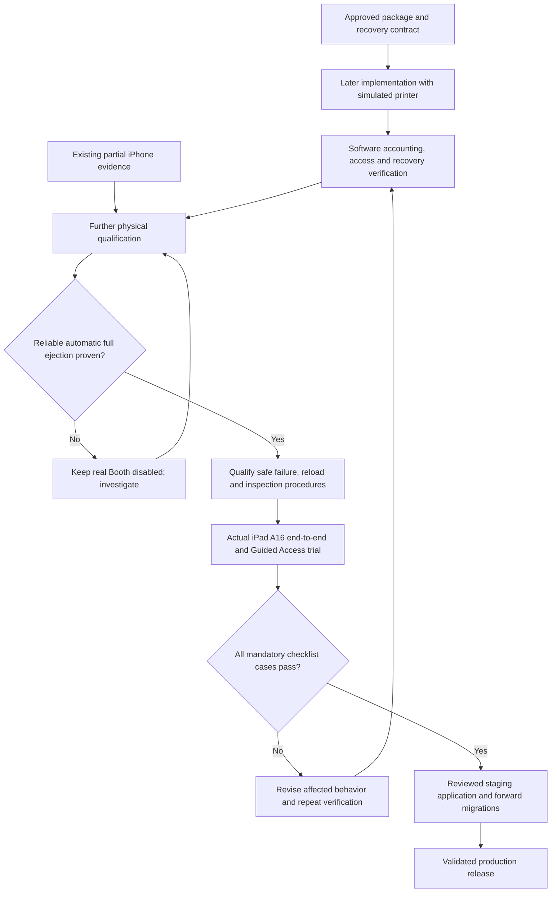

# Development, qualification and release flow

**Current target:** [ADR-0025](../adr/0025-package-accounting-and-booth-recovery.md), approved 2026-10-21. This documentation change does not implement the target.

Automatic normal completion is mandatory. Phone Printed / Not printed is exceptional recovery; it cannot replace automatic completion on every print. Reliable automatic reload detection is optional: physical reload plus phone confirmation is the approved fallback after its procedure passes qualification. Printer count is never physical inventory or booked capacity.

The [proof checklist](../qualification/booth-recovery-proof-checklist.md) names evidence, acceptance criteria and fallbacks. The [dated #17 report](../qualification/issue-17-trial-report.md) preserves observations without claiming the new flow passed. [Guest/phone route flow](../booth-user-flow.md) shows the proposed operating experience.

GitHub #9 describes contracts; #10 covers later integration; #17 owns printer evidence; #7 owns actual-device launch validation. [Issue update drafts](../github-issue-update-drafts.md) are local review material; no GitHub change or issue closure occurs in this documentation task.
