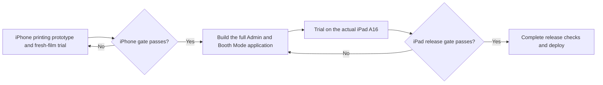
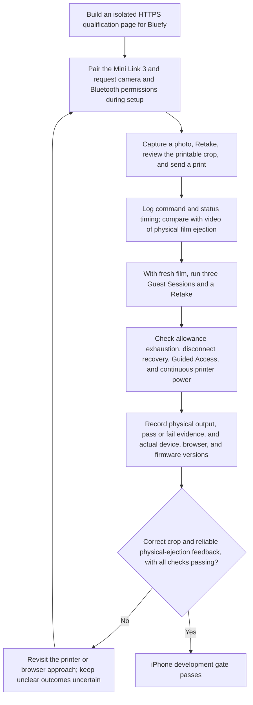
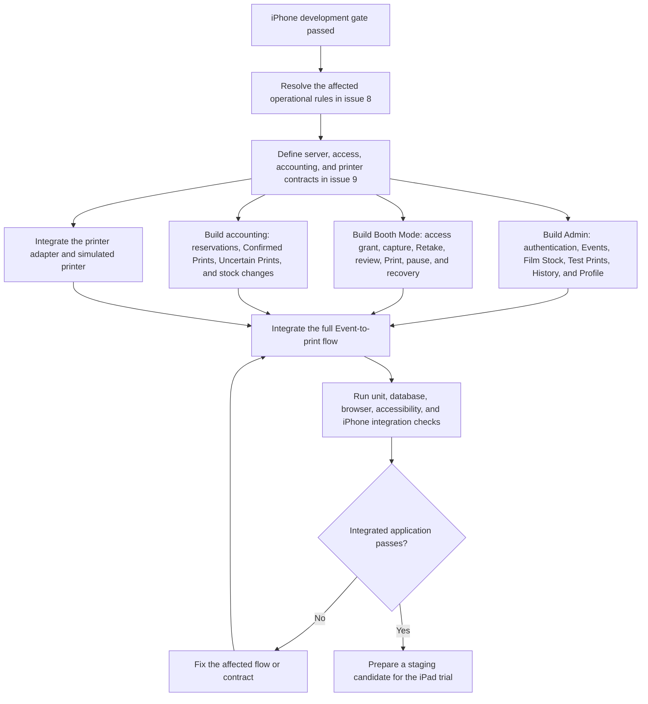
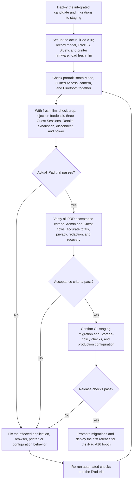

# Printing qualification to deployment

These diagrams show the agreed sequence in [PRD section 3](../../PRD.md#3-development-and-launch-feasibility-gates), [PRD section 8](../../PRD.md#8-acceptance-criteria), [ADR-0012](../adr/0012-qualify-development-on-iphone-before-ipad-launch.md), and the [issue #17 qualification design](../superpowers/specs/2026-10-13-iphone-print-qualification-design.md). The iPhone 15 Plus is a development device. The iPad A16 is the sole first-release Booth Mode device.

## 1. Build and qualify the iPhone printing prototype

Reported iPhone trial setup: iPhone 15 Plus on iOS 26.2.1, Bluefy 3.9.3, and Mini Link 3 firmware 0102(RX). Verify versions and fresh-film usability again for any new trial. The printer now reports zero sheets, and the development gate remains closed; see the [current trial report](../qualification/issue-17-trial-report.md). A command acknowledgement or Film Remaining change alone does not prove ejection. The independent Admin foundation may be built alongside this stage, but it is not required to pass the gate. Qualification prints are recorded manually; they are not Event Test Prints or Confirmed Prints.

## 2. Build the full Admin and Booth Mode application

The iPhone remains a development and test device during this stage. Passing this flow does not establish that the iPad A16 is ready for an Event.

## 3. Qualify the iPad and prepare deployment

Any change that affects the iPad trial or print outcome rules needs another verification pass before deployment. An iPhone pass never replaces this iPad release gate.
