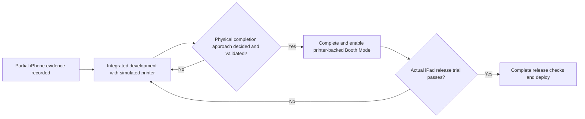
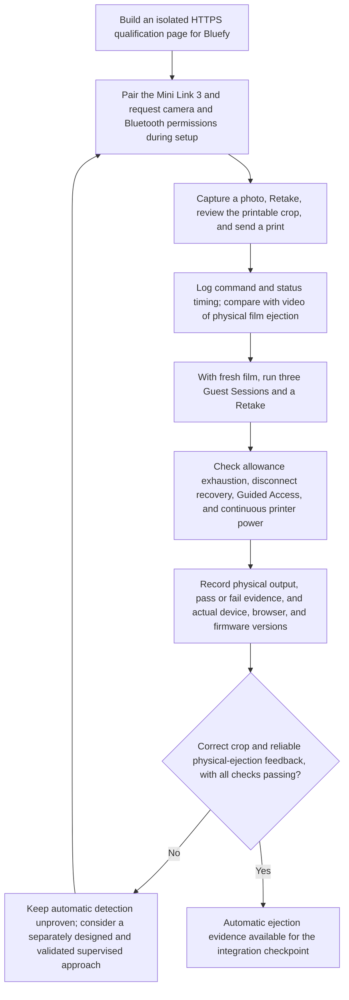
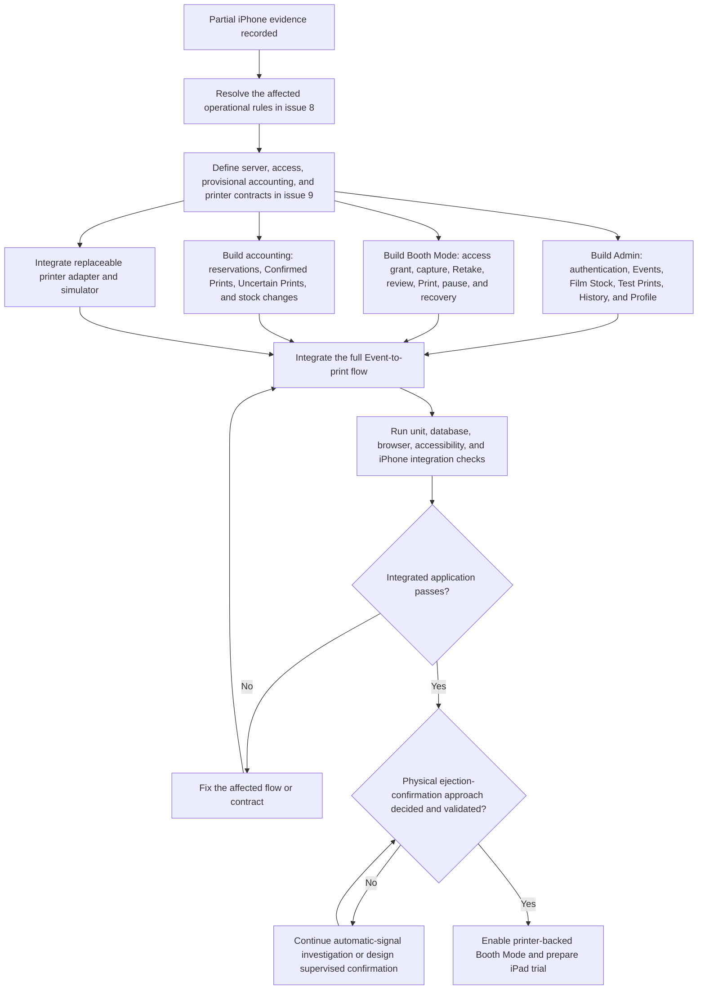
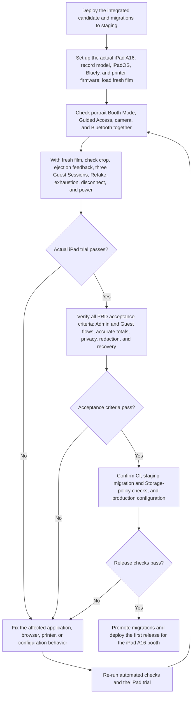

# Printing qualification to deployment

These diagrams show the current sequence in [PRD section 3](../../PRD.md#3-development-and-launch-feasibility-gates), [PRD section 8](../../PRD.md#8-acceptance-criteria), and [ADR-0021](../adr/0021-move-print-qualification-to-integration-checkpoint.md). The [original issue #17 qualification design](../superpowers/specs/2026-10-13-iphone-print-qualification-design.md) remains an evidence plan. The iPhone 15 Plus is a development device. The iPad A16 is the sole first-release Booth Mode device.

## 1. Continue iPhone printer qualification

Reported iPhone trial setup: iPhone 15 Plus on iOS 26.2.1, Bluefy 3.9.3, and Mini Link 3 firmware 0102(RX). Verify versions and fresh-film usability again for any new trial. Seven fresh-film prints matched the review; a separate three-used-sheet run exhausted local allowance. No physical sheet is now known to remain loaded, despite the latest printer-reported count of nine. See the [current trial report](../qualification/issue-17-trial-report.md). A command acknowledgement or Film Remaining change alone does not prove ejection. Integrated development may run in parallel with qualification, using a simulated printer. Qualification prints are recorded manually; they are not Event Test Prints or Confirmed Prints.

## 2. Develop and reach the physical completion checkpoint

The iPhone remains a development and test device during this stage. Code for Live Event and Booth Access Grants may be developed, but printer-backed Booth Mode, Test Prints, stock consumption, and Confirmed Print accounting must not be completed or enabled before the physical completion checkpoint. Passing this flow does not establish that the iPad A16 is ready for an Event.

## 3. Qualify the iPad and prepare deployment

Any change that affects the iPad trial or print outcome rules needs another verification pass before deployment. An iPhone pass never replaces this iPad release gate.
